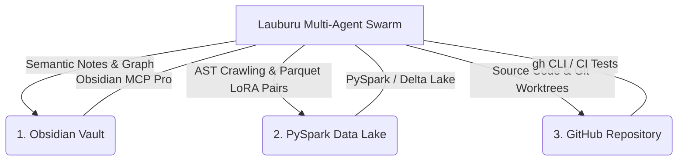

# 🏛️ Source 1: Lauburu Master Architecture & Tri-Vault Storage Protocol
*Generated for Google NotebookLM & Gemini Spark | Monorepo Canonical Source*
*Compilation Timestamp: 2026-10-14T14:16:14.829842+00:00*

---

## 1. Executive Summary & Core Rules
- **Rule #0 (Zero-Mock Data):** Strictly no fake arrays, simulated metrics, or dummy placeholders. All telemetry originates from live BLE hardware, authentic log replays, or shows clean waiting states (`--`).
- **Rule 6.3 (Storage Invariant):** Agents verify Tri-Vault storage layers are HEALTHY and ensure host NVMe maintains >= 5.0 GB free disk headroom.
- **$0 Cloud Spend Goal:** Prioritize local quantized models on Apple Silicon Metal and AMD ROCm over cloud APIs.

---

## 2. Canonical Tri-Vault Storage Specification
---
title: "Canonical Project Architecture, Storage Rule & Tooling Matrix"
tags: [canonical_rule, storage, tri_vault, mesh, tooling, truth_audit]
updated: "2026-10-13"
---

# Canonical Project Architecture, Storage Rule & Tooling Matrix
**Updated:** 2026-10-13
**Tags:** #architecture #mesh #obsidian #pyspark #github #swarm #mcp #rules #storage_health #self_healing
**Related Notes:** [[Index]], [[LAUBURU_MONOREPO_DEEP_ARCHITECTURE_INDEX]], [[PYSPARK_MONOREPO_CRAWL_AUG26]], [[APPS_AND_FEATURES_AUGUST_26_2026]]

---

## 🏛️ 1. Tri-Vault Storage Protocol

To ensure 100% data durability, rapid semantic recall, and big-data training throughput, all monorepo artifacts, codebases, and logs are synchronized across three canonical storage systems:



### 1.1 Obsidian Knowledge Vault
* **Location:** `/Users/aaron/DFS_UNIFIED/Lauburu-Monorepo/obsidian_vault/`
* **Protocol & MCP:** Connected via `obsidian-mcp-pro` (41 tools for vault search, graph traversal, frontmatter querying, Wikilinks, and Canvas manipulation).
* **Responsibilities:**
  - Dynamic architecture maps and RFC specs.
  - Multi-model AI debate consensus records.
  - Continuous swarm audit logs and test telemetry summaries.
  - High-level decision trees and visual UI audit mockups.

### 1.2 PySpark Big Data Lake & LoRA Vault
* **Location:** `/Users/aaron/DFS_UNIFIED/lora_datasets/` & `04_data_and_memory/`
* **Protocol & Engine:** Apache PySpark (`pyspark`), Delta Lake / Parquet columnar storage, Qdrant vector database.
* **Responsibilities:**
  - Automated continuous monorepo AST indexing (3,100+ code files, 435K+ LOC).
  - High-throughput ingestion of Pan-Tompkins 512Hz ECG streams and BLE sensor telemetry.
  - 24/7 LoRA dataset formatting (TRL, PEFT, DPO/RLHF instruction-tuning pairs).
  - Multi-model embedding caching and semantic clustering.

### 1.3 GitHub Monorepo & Worktrees
* **Location:** `aarontmaher/Lauburu-Monorepo` (Local Host: `/Users/aaron/DFS_UNIFIED/Lauburu-Monorepo`)
* **Protocol & CLI:** `gh` CLI, Git worktrees, atomic commit contracts, multi-tier CI test suites.
* **Responsibilities:**
  - Canonical production application and microservice code.
  - Multi-container Docker compose manifests (`docker-compose.connectivity.yml`).
  - Strict release tagging and zero-leak credential hygiene.

---

## 🧠 2. Canonical Local Inference Engine & Model Hierarchy

```text
┌─────────────────────────────────────────────────────────────────────────────┐
│                 CANONICAL LOCAL INFERENCE ENGINE HIERARCHY                  │
├─────────────────────────────────────────────────────────────────────────────┤
│ 1. PRIMARY ENGINE: prima.cpp                                                │
│    • Canonical primary master across all devices that contain the model     │
│      weights (Mac Mini M4 Pro, MacBook Pro, Linux Head Node).               │
│    • High-throughput Pipelined-Ring Parallelism over 40Gbps TB4 DMA Bridge. │
├─────────────────────────────────────────────────────────────────────────────┤
│ 2. RESILIENT FALLBACK: llama.cpp                                            │
│    • Strictly used as a fallback ONLY if an edge device lacks the local     │
│      model weights or hardware topology to run prima.cpp properly.          │
└─────────────────────────────────────────────────────────────────────────────┘
```

### 2.1 Canonical Models & Roles
* 👑 **#1 Supreme Local AI Training Target & Swarm Governor: `Qwen MoE (Mixture of Experts)`**
  - **Core Mission:** Highest-priority continuous local training target across all 7 layers to maximize swarm orchestration, multi-agent dispatch, subagent delegation, automated local AI training governance, and monorepo telemetry analysis.
  - **Expert Routing Topology:**
    - `Expert 0 (Swarm Governor):` Task decomposition, subagent delegation, timeout governance.
    - `Expert 1 (Debate Arbiter):` Tri-Orchestrator consensus formulation, ELO weighting, truth audit verification.
    - `Expert 2 (AST & Polyglot Coder):` PySpark AST traversal, code refactoring, Git worktree commits.
    - `Expert 3 (Biometrics & Telemetry DSP):` Movesense 512Hz ECG, Pan-Tompkins QRS filtering, ACWR recovery calculation.
    - `Expert 4 (Storage & Docker Infrastructure):` Virtio-FS validation, Qdrant vector sync, NetBird routing.
* **Master Local Orchestrator:** Target: `Qwen 3.8 Max 27B Abliterated` via `prima.cpp`. Runtime: Port 8082 (`decentralized_prima_daemon.py`), dynamically proxying to local inference endpoints: Port 8089 (`qwen2.5-0.5b-instruct-q4_k_m.gguf` for rapid micro-tasks) and Port 8085 (`Hermes-3-Llama-3.1-8B.Q4_K_M.gguf` for 8B execution).
* **Pinned Devil's Advocate & Red Team:** **`Qwen 3.8 Max Normal`** (`Qwen3.8-Max-Q4_K_M.gguf`) pinned on Port `:8083` (model path `/home/linuxmini/model_vault_gguf/Huihui-Qwen3.8-27B-abliterated-UD-Q4_K_XL.gguf` on L8 `lauburu` via 40Gbps TB4 Bridge).
* **Strict Duo Supremacy & Peripheral Offload:** The `Qwen 3.8 Max` duo exclusively utilizes the **`/screen-lens-sovereign`** capability for vision and speculative routing. The Mac Mini (L1) and Linux Mini Hub (L8 `lauburu`) maintain the primary 40Gbps compute backbone. All other project dependencies, networking tasks, background APIs, and auxiliary models MUST be aggressively pushed off to peripheral devices (L2-L7), which serve purely to aid the duo's functionality. Node L2 (MacBook Pro Intel i7) operates as the Screen Lens Sovereign Teacher Target unlinked from TB over LAN Wi-Fi / Tailscale.
* **Medical DSP & Kinematics Specialist:** `Pan-Tompkins DSP + Qwen2.5-Math-72B` distilled.


### 2.2 Mandatory Default Hand-Off to `/ai-debate` on Project Choices
**CANONICAL DIRECTIVE:** All swarms, orchestrators, subagents, and router sentinels MUST **default to handing off to the `/ai-debate` Dual Qwen and Cloud AI Debate** for all non-trivial project choices, architectural crossroads, and subsystem designs:
1. **Local Dual Qwen Arena:** Qwen 3.8 Max 27B Abliterated (Master Orchestrator on `:8081`/`:8082`) vs Qwen 3.8 Max (Devil's Advocate on `:8083` via TB4 Shard).
2. **Cloud Frontier Shadow:** Gemini 3.1 Pro High / Gemini 3.7 Flash High for deep architectural reasoning and edge-case verification.
3. **Consensus Invariant:** Decisions must achieve mathematical consensus ($\Phi \ge 0.98$) before code execution.

---

## ⚡ 3. Mandatory Storage Health & Pre-Flight Self-Healing Rule

**MANDATORY RULE:** Every AI agent must confirm the storage is **HEALTHY** and execute automated self-healing **BEFORE** making any changes, writing code, executing refactors, or running training tasks.

### 2.1 What is "Healthy Storage"?

| Vault Layer | Healthy State Criteria & Invariants | Unhealthy / Degraded Indicators |
| :--- | :--- | :--- |
| **1. Obsidian Vault** | • Directory `/Users/aaron/DFS_UNIFIED/Lauburu-Monorepo/obsidian_vault/` exists with `0755/0644` permissions.<br>• `Index.md` exists, non-empty, and contains valid master Wikilinks (`[[Index]]`, `[[LAUBURU_MONOREPO_DEEP_ARCHITECTURE_INDEX]]`, `[[CANONICAL_PROJECT_AND_STORAGE_RULE]]`).<br>• `obsidian-mcp-pro` environment variable `OBSIDIAN_VAULT_PATH` points to `/Users/aaron/DFS_UNIFIED`. | • Path unmounted or missing.<br>• Empty or corrupted `Index.md`.<br>• Permission denied errors on writing new notes. |
| **2. PySpark Data Lake** | • Inode paths `/Users/aaron/DFS_UNIFIED/lora_datasets/` and `04_data_and_memory/` exist.<br>• Training `.jsonl` datasets (`truth_audit_*.jsonl`, `ui_ux_improvements.jsonl`) are writable.<br>• Host NVMe maintains **$\ge$10.0 GB free disk headroom**.<br>• Qdrant Vector DB port (`127.0.0.1:6333` or local store) is reachable. | • Missing dataset directory.<br>• Free disk space `< 5.0 GB`.<br>• JSONL write locks or permission errors. |
| **3. GitHub Monorepo** | • `/Users/aaron/DFS_UNIFIED/Lauburu-Monorepo` is a valid git tree (`git rev-parse --is-inside-work-tree`).<br>• No stale lock files (`.git/index.lock` absent).<br>• Working tree is clean or has no unmerged conflict markers (`<<<<<<<`). | • `.git/index.lock` present preventing git operations.<br>• Detached HEAD or unresolvable merge conflicts. |

### 2.2 Pre-Flight Self-Healing Protocols (Execute BEFORE Modifying Code)

```bash
# 1. Self-Heal Missing Vault Directories & Symlinks
mkdir -p /Users/aaron/DFS_UNIFIED/Lauburu-Monorepo/obsidian_vault
mkdir -p /Users/aaron/DFS_UNIFIED/lora_datasets
mkdir -p /Users/aaron/DFS_UNIFIED/Lauburu-Monorepo/04_data_and_memory

# 2. Self-Heal Stale Git Locks
if [ -f "/Users/aaron/DFS_UNIFIED/Lauburu-Monorepo/.git/index.lock" ]; then
    rm -f "/Users/aaron/DFS_UNIFIED/Lauburu-Monorepo/.git/index.lock"
fi

# 3. Self-Heal Disk Headroom (If < 5.0 GB Free)
find /Users/aaron/teamwork_projects -type d -name "__pycache__" -exec rm -rf {} + 2>/dev/null || true
find /Users/aaron/teamwork_projects -type d -name ".pytest_cache" -exec rm -rf {} + 2>/dev/null || true
find /Users/aaron/DFS_UNIFIED/Lauburu-Monorepo/logs -name "*.log" -mtime +7 -delete 2>/dev/null || true

# 4. Self-Heal Obsidian Master Index (If missing)
if [ ! -s "/Users/aaron/DFS_UNIFIED/Lauburu-Monorepo/obsidian_vault/Index.md" ]; then
    cat << 'EOF' > /Users/aaron/DFS_UNIFIED/Lauburu-Monorepo/obsidian_vault/Index.md
---
title: "Lauburu AI Monorepo - Master Knowledge Graph"
tags: [lauburu, root, master_index, swarm, ai_debate]
---
# 🧠 Lauburu AI Monorepo - Master Knowledge Vault
- [[CANONICAL_PROJECT_AND_STORAGE_RULE]]
- [[LAUBURU_MONOREPO_DEEP_ARCHITECTURE_INDEX]]
- [[Index]]
EOF
fi
```

---

## 🌐 3. 8-Layer Mesh Topology & Dynamic RAM Ceilings

The Lauburu Mesh pools decentralized AI VRAM and compute across 8 physical layers:

| Hardware Layer | Node Name | Network Role | Local IP | Tailscale / Bridge IP | Dynamic RAM Ceiling | Hardware & Capabilities |
| :--- | :--- | :--- | :--- | :--- | :--- | :--- |
| **Layer 1: Host Mac** | `Mac_Node` | Primary Host & Memory Governor | `192.168.8.143` (Wi-Fi) / `192.168.8.230` (LAN) | `100.119.199.76` | **80%** (>=4.8 GB Free) | Apple M4 Pro Mac Mini. Primary controller, memory governor, prompt ingestion. |
| **Layer 2: MacBook Pro** | `MacBook_Pro` | Model Vault & x86_64 Worker | `192.168.8.127` | TB `10.0.0.4` / `100.103.212.21` | **90%** (14.0 GB AI) | Intel i7 MacBook Pro, 285 GB SSD model vault, 40 Gb/s TB Receptacle 3 (MTU 9000), LAN/Tailscale link. |
| **Layer 1b: Mac Mini M2** | `MacMini_M2` | Secondary Compute Node | `192.168.8.114` | TB `10.0.0.3` / `100.104.128.34` | **85%** (13.6 GB AI) | Apple M2 Pro Mac Mini, 40 Gb/s TB Receptacle 2 (0.43ms RTT), local inference & validation. |
| **Layer 3: Linux Hub** | `Linux_Head_Node` | Gateway Ingress & Compute Hub | `192.168.8.225` | `100.101.39.98` | **80%** (12.0 GB AI) | AMD Ryzen 7 5700U, Docker Engine, Petals DHT Bootstrap & Apache Ray Head. |
| **Layer 4: Linux Tablet** | `Linux_Tablet` | Mobile Compute & Touch DSP | `192.168.8.116` | `100.80.64.5` | **75%** (6.0 GB AI) | Debian Linux Tablet (`debian-1`), secondary worker, lightweight biometrics telemetry. |
| **Layer 5: MacBook Air** | `MacBook_Air` | Secondary High-Speed Metal Worker | `192.168.8.248` | `100.121.202.34` | **90%** (14.0 GB AI) | Apple M4 MacBook Air, Metal Performance Shaders, LoRA fine-tuning & model distillation. |
| **Layer 6: Pixel** | `Pixel_10_Pro_XL` | 8K Vision Stream & Edge TPU | `192.168.8.213` | `100.114.215.68` | **85%** (12.5 GB AI) | Google Tensor G5, Edge TPU, 8K Digital PTZ, UWB 3D Spatial Positioning Anchor. |
| **Layer 7: Samsung S20** | `Samsung_S20` | Dedicated Automated UI Tester | `192.168.8.157` | `100.84.40.95` | **75%** (9.0 GB AI) | Samsung Exynos 990, ADB default target for OpenClaw automated audits. |
| **Layer 8: Linux Mini** | `Linux_Mini` | Central Hub & High-RAM Compute | `192.168.8.242` | TB `10.0.0.8` / `100.121.247.8` | **80%** (25.6 GB AI) | `lauburu` Intel Core i7-8700B, 32GB RAM, **40Gbps Thunderbolt bridge (0.14ms probed RTT)**. |
| **Infrastructure Gateway** | `GL.iNet Router` | Core Gateway & USB Bridge | `192.168.8.1` | `100.70.123.123` | Embedded (2 GB RAM) | GL-BE14000 (OpenWrt), 2.5G NBN eth2 WAN, USB hardware ADB daemon. |

---

---

## 👁️ 4. Canonical Multimodal Perception & Development Historian Layer

The **Screen Lens & AI Development Historian Subsystem** (`01_apps/screen_lens/`) is a default, permanent perception layer across the entire monorepo and swarm:

```text
┌─────────────────────────────────────────────────────────────────────────────┐
│                 CANONICAL SCREEN LENS MULTIMODAL TOPOLOGY                   │
├─────────────────────────────────────────────────────────────────────────────┤
│ 1. macOS Host Lens (Port 3035): ScreenCaptureKit + Apple Vision ANE OCR.    │
│ 2. Android Edge Lens (Port 3035 / 3036): Pixel 10 Pro XL Tesseract LSTM.    │
│ 3. Swarm Client: 05_agents_and_swarms/screen_lens_swarm_client.py           │
│    • Provides instant screen_lens_swarm_client.get_active_screen_summary(). │
│ 4. Autonomous Historian: 24/7 development synthesis logging to              │
│    obsidian_vault/00_CHRONOLOGY/LIVE_DEVELOPMENT_LOG_2026.md and            │
│    04_data_and_memory/lora_datasets/project_development_history.jsonl.      │
└─────────────────────────────────────────────────────────────────────────────┘
```

---

## 📁 5. Canonical Monorepo Folder Map

```text
Lauburu-Monorepo/
├── 00_core_infrastructure/           # Self-Healing Hub (Port 18802), SeaweedFS DFS, Docker Compose, Tailscale daemons
├── 01_apps/                          # Screen Lens (:3035), Port 4000 Hub, Movesense Hub, Zone 2, Spatial Grappling 3D
├── 02_ai_models_and_inference/       # prima.cpp PRP (:8082), llama.cpp (:8083), Petals DHT, Exo P2P, GGUF Vault
├── 03_biometrics_and_telemetry/      # Movesense BLE, Pan-Tompkins QRS DSP, PTT Blood Pressure, DFA-alpha1
├── 04_data_and_memory/               # PySpark Crawlers, 24/7 LoRA Datasets, Qdrant Vector DB, Google Drive Sync
├── 05_agents_and_swarms/             # Screen Lens Swarm Client, Tri-Orchestrator AI Debate, Genetic MoE Engine
├── 06_scripts_and_tooling/           # Universal SSH Daemons, ADB Keepalive, WoL Resurrection, Figma MCP Bridge
├── 07_docs_and_architecture/         # Monorepo Deep Architecture Indexes, Whitepapers, Security RFCs
├── obsidian_vault/                   # Canonical Obsidian Knowledge Graph, APPS_AND_FEATURES, Swarm Logs
└── teamwork_projects/                # 32 Active Federated Projects (software_dev, internet_training, etc.)
```

---

## 🛑 6. Core Operating Principles

1. **Rule #0 (Zero-Mock Data & Zero-Simulation Mandate):** No fake arrays, synthetic placeholders, or simulated telemetry. All data must originate from authentic live hardware streams or real log replays.
   * **Rule 0.1 (Definitive Pr

... [Truncated for NotebookLM source limits from 23447 chars]

---

## 3. Monorepo Root Overview
# 🧠 Lauburu AI Monorepo — Canonical Architecture & Unified Storage Hub (1.701 TB)

```
┌─────────────────────────────────────────────────────────────────────────────┐
│                       LAUBURU MESH UNIFIED ARCHITECTURE                     │
│               1.701 TB SeaweedFS DFS  •  139 GB Pooled RAM (108.4 GB VRAM)  │
│            40Gbps Thunderbolt 4  •  Tri-Vault Synchronization Layer         │
└─────────────────────────────────────────────────────────────────────────────┘
```

## 📖 Overview
The **Lauburu Monorepo** is the canonical source code, model inference, biometrics, and AI orchestration repository for the **Lauburu Mesh Ecosystem**. The workspace is distributed across an **8-node heterogeneous physical hardware mesh + gateway** interconnected via a **40Gbps Thunderbolt 4 DMA bridge (0.38ms RTT)** to L8 `lauburu`, 2.5G wired NBN, and an encrypted **Tailscale WireGuard mesh**, unified on top of a **1.701 TB SeaweedFS Distributed Object & File System** mounted at `/Users/aaron/DFS_UNIFIED`.

---

## 🏛️ 1. Canonical Tri-Vault Storage Architecture

All state, telemetry, training runs, and architectural whitepapers are synchronized across three persistent storage vaults:

```
┌─────────────────────────────────────────────────────────────────────────────┐
│                    TRI-VAULT STORAGE SYNCHRONIZATION                        │
├─────────────────────────────────────────────────────────────────────────────┤
│ 1. OBSIDIAN VAULT (Human & Semantic Knowledge Core)                         │
│    • Path: /Users/aaron/DFS_UNIFIED/Lauburu-Monorepo/obsidian_vault/        │
│    • Managed via: Obsidian MCP Pro (41 graph traversal tools, Wikilinks)   │
│    • Content: System specifications, live debate transcripts, audit logs.  │
├─────────────────────────────────────────────────────────────────────────────┤
│ 2. PYSPARK & BIG DATA LAKE (High-Throughput Computation & Datasets)         │
│    • Paths: /Users/aaron/DFS_UNIFIED/lora_datasets/ & 04_data_and_memory/   │
│    • Engine: PySpark, Delta Lake (delta-rs), Qdrant Vector DB, Parquet      │
│    • Content: 3,100+ code file AST crawls, 435K+ LOC index, 24/7 DPO LoRA   │
│      instruction pairs, 512Hz raw ECG streams.                              │
├─────────────────────────────────────────────────────────────────────────────┤
│ 3. GITHUB REPOSITORY & WORKTREES (Canonical Source Code & Version Control)  │
│    • Repo: aarontmaher/Lauburu-Monorepo (Host: /Users/aaron/DFS_UNIFIED)    │
│    • Managed via: gh CLI, Git Worktrees, Automated Multi-Tier CI Test Suites│
│    • Content: Microservices, client apps, container definitions, drivers.   │
└─────────────────────────────────────────────────────────────────────────────┘
```

---

## 🌐 2. Physical Mesh Hardware Matrix (8 Nodes + Gateway)

The distributed hardware mesh pools **139.0 GB RAM (108.4 GB Usable AI VRAM)** across 8 physical compute nodes and 1 dedicated gateway router:

| Layer | Node Name | Network Role | Local IP | Tailscale / Bridge IP | RAM / AI Cap | Key Roles & Protocols |
| :--- | :--- | :--- | :--- | :--- | :--- | :--- |
| **L1** | `Mac_Node` | Primary Host & Memory Governor | `192.168.8.143` / `.230` | `100.119.199.76` (TB: `10.0.0.2`) | 24.0 GB (19.2 GB AI) | Apple M4 Pro Mac Mini. Prompt Ingestion, Screen Lens, & Memory Governor. Cap: 80% (>=4.8 GB free). |
| **L8** | `Linux_Mini (lauburu)` | TB4 DMA Hub & Model Vault | `192.168.8.242` | `100.121.247.8` (TB: `10.0.0.8`) | 32.0 GB (25.6 GB AI) | **40Gbps Thunderbolt 4 Bridge (0.38ms RTT)**, GGUF Model Vault Hub, Glances v4 (:61208). Cap: 80%. |
| **L2** | `MacBook_Pro` | Model Vault & Automation Target | `192.168.8.127` | `100.103.212.21` | 16.0 GB (14.0 GB AI) | Intel Core i7-9750H, 16 GB RAM (x86_64). UNLINKED from TB, LAN Wi-Fi / Tailscale link. Cap: 90%. |
| **L3** | `Linux_Head_Node` | Gateway Ingress & Compute Hub | `192.168.8.225` | `100.101.39.98` | 15.0 GB (12.0 GB AI) | AMD Ryzen 7 5700U, Docker Hub, Ray Cluster, First-Offload Target (Rule 10). Cap: 80%. |
| **L4** | `Linux_Tablet` | Mobile Linux Compute & Touch DSP | `192.168.8.116` (Port 2) | `100.80.64.5` | 8.0 GB (6.0 GB AI) | Debian Linux (`debian-1`), Bedside TUI, Router Port 2 Wired (0.95ms RTT). Cap: 75%. |
| **L5** | `MacBook_Air` | Secondary Metal Worker & LoRA | `192.168.8.248` | `100.121.202.34` | 16.0 GB (14.0 GB AI) | Apple M4 MacBook Air, Metal Performance Shaders, LoRA Distillation. Cap: 90%. |
| **L6** | `Pixel_10_Pro_XL` | 8K Vision Stream & Edge TPU | `192.168.8.213` | `100.114.215.68` | 16.0 GB (13.6 GB AI) | Google Tensor G5, Edge TPU, 8K Digital PTZ, Termux SSH (:8022). Cap: 85%. |
| **L7** | `Samsung_S20` | Dedicated Automated UI Tester | `192.168.8.157` | `100.84.40.95` | 12.0 GB (9.0 GB AI) | Samsung Exynos 990, Router USB ADB default target for OpenClaw UI. Cap: 75%. |
| **GW** | `GL.iNet Router` | Core Gateway & USB Bridge | `192.168.8.1` | `100.70.123.123` | 2.0 GB (1.38 GB free) | GL-BE14000 (OpenWrt), 2.5G NBN WAN (`eth2`, 12ms RTT), USB Hardware ADB Bus. |

---

## 📁 3. Canonical Monorepo Directory Layout (13 Canonical Pillars)

All repository code is organized into 13 numbered canonical pillars, ensuring strict separation of concerns:

```
/Users/aaron/DFS_UNIFIED/Lauburu-Monorepo/
├── 00_core_infrastructure/           # Master SeaweedFS, Docker, Tailscale, daemons, launchd units
├── 01_apps/                          # Client applications (Port 4000 Hub, Movesense Hub, Zone 2, Quartz)
├── 02_ai_models_and_inference/       # llama.cpp RPC (8081-8085), Petals, Exo, GGUF Vault, Prima.cpp
├── 03_biometrics_and_telemetry/      # Movesense 512Hz ECG, Pan-Tompkins QRS, PTT BP, DFA-alpha1
├── 04_data_and_memory/               # PySpark Data Lake, 24/7 LoRA datasets, Qdrant Vector DB
├── 05_agents_and_swarms/             # Tri-Orchestrator Soul, Genetic MoE Engine, Antigravity Skills
├── 06_scripts_and_tooling/           # Autonomous network self-healing, global NAS mounting, ADB daemons
├── 07_docs_and_architecture/         # Architecture whitepapers, hardware topologies, spec sheets
├── 08_business_and_commerce/         # Shopify Storefront GraphQL, Subscriptions, CAC/LTV modeling
├── 09_app_store_and_release/         # Signed Android APKs, Play Store & Apple App Store release manifests
├── 10_spatial_grappling_kinematics/  # 955-Node Spatial OPML trees, 3D tatami world models, kinematics
├── 11_security_and_governance/       # Hardware isolation, SSH/RPC socket encryption, Cloudflare HMAC
├── 12_continuous_lora_evolution/     # 24/7 LoRA harvesting, DARE-TIES weight merging, MLX backprop
├── obsidian_vault/                   # Canonical Obsidian Knowledge Graph (Tri-Vault Layer 1)
└── tests/                            # Multi-tier verification test suites & regression benchmarks
```

---

## 🧹 4. Legacy Root Directory Consolidation Plan (README Mode)

To maintain backward compatibility while organizing the repository, legacy root directories will transition via non-destructive symlinks:

| Legacy Root Directory | Canonical Destination | Consolidation & Symlink Policy |
| :--- | :--- | :--- |
| `00_SYSTEM_DASHBOARDS/` | [00_core_infrastructure/dashboards](file:///Users/aaron/DFS_UNIFIED/Lauburu-Monorepo/00_core_infrastructure) & [01_apps](file:///Users/aaron/DFS_UNIFIED/Lauburu-Monorepo/01_apps) | Consolidate system monitoring UI and Prometheus/Grafana configs. |
| `ai_debate/` | [05_agents_and_swarms/ai_debate](file:///Users/aaron/DFS_UNIFIED/Lauburu-Monorepo/05_agents_and_swarms/ai_debate) | Consolidated; maintain symlink `ai_debate -> 05_agents_and_swarms/ai_debate`. |
| `apps/` | [01_apps](file:///Users/aaron/DFS_UNIFIED/Lauburu-Monorepo/01_apps) | Merge residual apps; replace with symlink `apps -> 01_apps`. |
| `core/` | [00_core_infrastructure](file:///Users/aaron/DFS_UNIFIED/Lauburu-Monorepo/00_core_infrastructure) | Merge system configs; replace with symlink `core -> 00_core_infrastructure`. |
| `docs/` | [07_docs_and_architecture](file:///Users/aaron/DFS_UNIFIED/Lauburu-Monorepo/07_docs_and_architecture) | Consolidate specifications; replace with symlink `docs -> 07_docs_and_architecture`. |
| `filerldb2/` | [00_core_infrastructure/seaweedfs/filerldb2](file:///Users/aaron/DFS_UNIFIED/Lauburu-Monorepo/00_core_infrastructure) | Move SeaweedFS local leveldb database out of git root into infrastructure data. |
| `Installed_Apps/` | [01_apps/installed](file:///Users/aaron/DFS_UNIFIED/Lauburu-Monorepo/01_apps) | Catalog installed tooling binaries and runtime wrappers. |
| `lora_datasets/` | [04_data_and_memory/lora_datasets](file:///Users/aaron/DFS_UNIFIED/Lauburu-Monorepo/04_data_and_memory) | Maintain symlink pointing to high-capacity DFS dataset pool. |
| `pyspark_analytics/` | [04_data_and_memory/pyspark_analytics](file:///Users/aaron/DFS_UNIFIED/Lauburu-Monorepo/04_data_and_memory) | Consolidate AST indexers and Parquet crawlers into data pillar. |
| `scripts/` | [06_scripts_and_tooling](file:///Users/aaron/DFS_UNIFIED/Lauburu-Monorepo/06_scripts_and_tooling) | Consolidate operational scripts; maintain symlink `scripts -> 06_scripts_and_tooling`. |
| `self_healing_hub/` | [06_scripts_and_tooling/network/self_healing_hub](file:///Users/aaron/DFS_UNIFIED/Lauburu-Monorepo/06_scripts_and_tooling) | Integrate into Nomad Courier self-healing daemon hierarchy. |
| `webapp/` | [01_apps/webapp](file:///Users/aaron/DFS_UNIFIED/Lauburu-Monorepo/01_apps) | Web dashboard frontend; maintain symlink `webapp -> 01_apps/webapp`. |

---

## 🤖 5. Sovereign Local AI Hierarchy & Uptime Governance

All local inference and orchestration across the 7-layer mesh strictly follows the **Sovereign Local AI Hierarchy Invariant**:

### 5.1 Sovereign Master Local Orchestrator: Qwen 3.8 Max (Port 8082)
- **Target Architecture:** **`qwen_38_max`** (prima.cpp PRP over the 40Gbps TB4 DMA Bridge to L8 `lauburu`).
- **Runtime Reality (Rule 0):** `decentralized_prima_daemon.py` proxy forwarding to `llama-server` on Port 8090 serving `Hermes-3-Llama-3.1-8B.Q4_K_M.gguf`.
- **Endpoint:** `http://127.0.0.1:8082/v1/models`
- **Role:** Master Local Orchestrator leading all debate consensus, architectural decisions, and multi-agent coordination.

### 5.2 Canonical Devil's Advocate & Adversarial Red Team (Port 8083)
- **Target Model:** **`qwen_38_max_abliterated`**
- **Model Path:** `/home/linuxmini/model_vault_gguf/Huihui-Qwen3.8-27B-abliterated-UD-Q4_K_XL.gguf` on L8 `lauburu`.
- **Endpoint:** `http://127.0.0.1:8083/health`
- **Role:** Uncensored adversarial challenger red-teaming every proposed change before sign-off. Zero prompts from this plane leak to external cloud APIs.

### 5.3 Subordinate Syntax Worker ONLY (Port 8081)
- **Model Runtime:** `mesh_multiport_bridge.py` proxy returning `Qwen2.5-VL-7B-Instruct-Q4_K_M`
- **Endpoint:** `http://127.0.0.1:8081/health`
- **Role:** Strictly subordinate single-file AST syntax parser, linter, and diff validator. PROHIBITED from acting as orchestrator or leading debates.

---

## ⚡ 6. Network Combined Storage Management (`/Users/aaron/DFS_UNIFIED`)

### 6.1 Cluster Ports & Endpoints
- **SeaweedFS Master:** `127.0.0.1:9333` (gRPC: `19333`)
- **SeaweedFS Filer:** `127.0.0.1:8888` / `8088` (gRPC: `18888`)
- **SeaweedFS Volume Server:** `127.0.0.1:8080` (gRPC: `18080`)
- **WebDAV Gateway:** `127.0.0.1:7333` (Direct HTTP/Finder access)
- **Samba SMB3:** `100.101.39.98:445` (Apple VFS Fruit extensions)
- **Local FUSE Mount:** `/Users/aaron/DFS_UNIFIED` (Logical Capacity: 1.701 TB)

### 6.2 Autonomous Keepalive Daemon
Managed 24/7 by [nomad_courier_self_healer.py](file:///Users/aaron/DFS_UNIFIED/Lauburu-Monorepo/06_scripts_and_tooling/network/nomad_courier_self_healer.py):
```bash
# Execute single health & mount verification cycle:
python3 /Users/aaron/DFS_UNIFIED/Lauburu-Monorepo/06_scripts_and_tooling/network/nomad_courier_self_healer.py --once

# Inspect live status telemetry:
cat /Users/aaron/DFS_UNIFIED/Lauburu-Monorepo/data/network/nomad_self_healer_status.json
```

---

## 🛠️ 7. Operational Runbook & Unified CLI Tooling

All primary tools are compiled native binaries located in `/Users/aaron/.local/bin/`:

### 7.1 Master Network Orchestrator (`lauburu-network`)
```bash
lauburu-network --tree   # Prints full 6-tier transport & 7-layer hardware topology tree
lauburu-network --test   # Headless network prober self-test (all 11 targets in <1.5s)
lauburu-network --json   # Emits structured JSON network telemetry
lauburu-network          # Launch interactive 120 FPS dual-pane network TUI
```

### 7.2 Master Applications Orchestrator (`lauburu-apps`)
```bash
lauburu-apps --tree      # Prints 6-domain 30-app organizational tree
lauburu-apps --test      # Headless probe self-test across all 30 apps
lauburu-apps --json      # Emits structured JSON applications state
lauburu-apps             # Launch interactive 120 FPS application lifecycle manager
```

### 7.3 Master Monorepo Observability Workbench (`lauburu-monitor`)
```bash
lauburu-monitor --test   # Headless full-monorepo AST, mesh, and storage verification
lauburu-monitor          # Launch interactive 6-tab system monitor (AST, Ports, Mesh, Apps, Pillars, Vault)
```

### 7.4 Live Swarm & Mach RAM Lens (`lauburu_health_tui`)
```bash
lauburu_health_tui --snapshot # One-shot authentic Mach RAM (16KB pages) & mesh probe
lauburu_health_tui            # Interactive RAM and continuous training HUD
```

### 7.5 Verify Local AI Inference Endpoints
```bash
curl -s http://127.0.0.1:8082/v1/models && echo "Qwen 3.8 Max Master (8082): ONLINE"
curl -s http://127.0.0.1:8083/health    && echo "Qwen 3.8 Max 27B Abliterated Red Team (8083): ONLINE"
curl -s http://127.0.0.1:8081/health    && echo "Qwen 2.5 Coder 7B Syntax Worker (8081): ONLINE"
```

### 7.3 Execute Tri-Vault Pre-Flight Self-Healing
```bash
# 1. Ensure vault directories exist
mkdir -p /Users/aaron/DFS_UNIFIED/Lauburu-Monorepo/obsidian_vault /Users/aaron/DFS_UNIFIED/lora_datasets /Users/aaron/DFS_UNIFIED/Lauburu-Monorepo/04_data_and_memory

# 2. Release stale git index locks
[ -f "/Users/aaron/DFS_UNIFIED/Lauburu-Monorepo/.git/index.lock" ] && rm -f "/Users/aaron/DFS_UNIFIED/Lauburu-Monorepo/.git/index.lock"
```

---

## 📋 8. Compliance & Governance Invariants
1. **Rule #0 Zero-Mock Mandate:** No simulated, mocked, or placeholder data. Telemetry originates exclusively from live BLE sensors, live network sockets, and authentic hardware.
2. **Dynamic RAM Governance (Rule 3):** Host Mac Mini M4 Pro RAM allocation must remain $\le 80\%$ ($\ge 4.8\text{ GB}$ untouched physical RAM buffer at all times to prevent ACIO2 panics).
3. **Continuous DPO LoRA Serialization:** All self-healing actions, debate verdicts, and storage reorganizations are serialized to `data/lora_datasets/` for 24/7 background learning.
