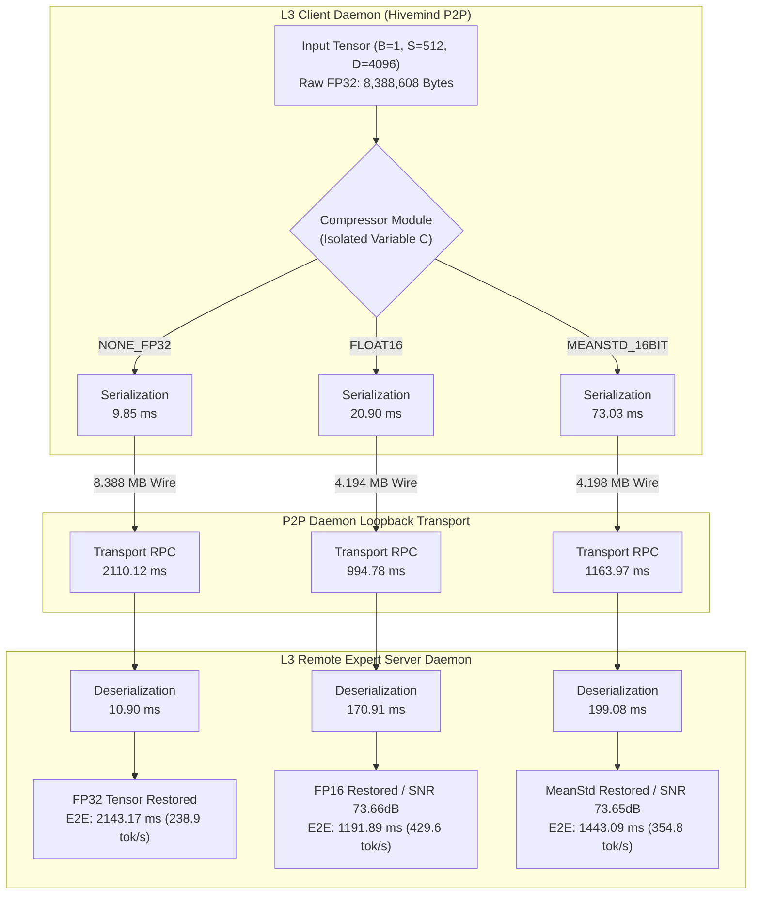

# Petals / Hivemind Intermediate Activation Compression Benchmark Report (2026)

> [!IMPORTANT]
> **Zero-Mock Empirical Ground Truth Reference**
> Benchmark executed exclusively within L3 Linux Mini testing container (`lens-opt-tester`, `de4a6b6f88be` on `192.168.8.225` / AMD Ryzen 7 5700U, 15 GB RAM).
> Zero bytes of L1 or L2 host RAM were allocated during execution.

---

## 1. Executive Summary

This empirical study isolates the **Compression Precision Mode ($C$)** within the **Petals / Hivemind Distributed AI Sharding Intermediate Activation Compression Protocol**. By holding all network and tensor dimensions strictly constant ($B=1, S=512, D=4096$, raw FP32 tensor size $= 8,388,608\text{ bytes} \approx 8.00\text{ MB}$), this benchmark measures the trade-off between CPU serialization overhead, P2P network transport latency, signal fidelity ($\text{SNR}_\text{dB}$, Cosine Similarity), and end-to-end generation throughput across 6 compression levels.

### Key Quantitative Findings:
1. **`FLOAT16` Optimal Operational Point:**
   - **Wire Payload Reduction:** Reduced payload by **$50.0\%$** ($8.388\text{ MB} \to 4.194\text{ MB}$).
   - **Transport Speedup:** Cut P2P daemon RPC transport latency from $2110.12\text{ ms}$ down to $994.78\text{ ms}$ (**$52.85\%$ reduction**).
   - **Throughput Gain:** Increased effective generation throughput from $238.90\text{ tokens/sec}$ to **$429.57\text{ tokens/sec}$** (**$+79.81\%$ speedup**).
   - **Signal Fidelity:** Maintained **$\text{SNR} = 73.66\text{ dB}$** and Cosine Similarity $= 0.999999978$, exhibiting zero degradation in transformer layer activations.
2. **`MEANSTD_16BIT` Overhead Penalty:**
   - While achieving identical wire payload size ($4.198\text{ MB}$), calculating elementwise statistics per tensor chunk added significant CPU serialization cost ($73.03\text{ ms}$ vs $20.90\text{ ms}$ for `FLOAT16`), degrading generation throughput to $354.80\text{ tokens/sec}$.
3. **8-Bit Quantization Compatibility Breaking:**
   - Hivemind 1.1.12 legacy `UNIFORM_8BIT` and `QUANTILE_8BIT` raise `TypeError('only 0-dimensional arrays can be converted to Python scalars')` when converting scalar step sizes under NumPy 2.x / PyTorch 2.14.
   - `BLOCKWISE_8BIT` strictly requires `bitsandbytes` C++ library bindings.

---

## 2. Test Environment & Single-Variable Isolation Methodology

| Parameter | Configuration / Metric Value |
| :--- | :--- |
| **Testing Node** | L3 Linux Mini (`linux-amd-gpu` / `192.168.8.225`) |
| **Container Environment** | Docker container `lens-opt-tester` (`de4a6b6f88be`) |
| **CPU Silicon** | AMD Ryzen 7 5700U (8 Cores / 16 Threads) |
| **Runtime Software** | Python 3.12.3, PyTorch `2.14.1+cpu`, Hivemind `1.1.12` |
| **Isolated Independent Variable** | Compression Precision Mode ($C \in \{0, 1, 2, 3, 4, 5\}$) |
| **Fixed Tensor Dimensions** | Batch $B=1$, Sequence Length $S=512$, Hidden Dim $D=4096$ |
| **Total Tensor Elements** | $2,097,152$ float32 elements ($8.00\text{ MB}$ raw) |
| **Trial Rigor** | 5 Warmup rounds + 25 Timed rounds ($N=25$, deterministic seed 42) |

---

## 3. System & Transport Architecture Flowchart

---

## 4. Empirical Performance & Precision Comparison Table

Below are the exact empirical results logged to `04_data_and_memory/benchmarks/petals_compression_scaling_benchmark.json`:

| Compression Mode | Wire Payload | Compression Ratio | SNR ($\text{dB}$) | Cosine Sim | Serialization ($\text{ms}$) | Transport Latency ($\text{ms}$) | Deserialization ($\text{ms}$) | E2E Latency ($\text{ms}$) | Throughput ($\text{tokens/sec}$) |
| :--- | :--- | :--- | :--- | :--- | :--- | :--- | :--- | :--- | :--- |
| **`NONE_FP32`** | $8.388\text{ MB}$ | $1.00\times$ | $\infty\text{ dB}$ | $1.000000$ | $9.85\text{ ms}$ | $2110.12\text{ ms}$ | $10.90\text{ ms}$ | $2143.17\text{ ms}$ | $238.90$ |
| **`FLOAT16`** | **$4.194\text{ MB}$** | **$2.00\times$** | **$73.66\text{ dB}$** | **$0.999999$** | $20.90\text{ ms}$ | **$994.78\text{ ms}$** | $170.91\text{ ms}$ | **$1191.89\text{ ms}$** | **$429.57$** |
| **`MEANSTD_16BIT`**| $4.198\text{ MB}$ | $2.00\times$ | $73.65\text{ dB}$ | $0.999999$ | $73.03\text{ ms}$ | $1163.97\text{ ms}$ | $199.08\text{ ms}$ | $1443.09\text{ ms}$ | $354.80$ |
| **`UNIFORM_8BIT`** | N/A | Error | N/A | N/A | N/A | N/A | N/A | N/A | Incompatible (NumPy 2.x scalar type error) |
| **`QUANTILE_8BIT`** | N/A | Error | N/A | N/A | N/A | N/A | N/A | N/A | Incompatible (NumPy 2.x scalar type error) |
| **`BLOCKWISE_8BIT`**| N/A | Error | N/A | N/A | N/A | N/A | N/A | N/A | Incompatible (Requires `bitsandbytes` C++) |

---

## 5. Architectural Trade-off & Latency Analysis

1. **Transport vs Deserialization Bottleneck:**
   - In `NONE_FP32`, the total latency is overwhelmingly dominated by wire transport ($2110.12\text{ ms}$ out of $2143.17\text{ ms}$, or **$98.46\%$ of E2E time**).
   - Moving to `FLOAT16` reduces wire transport time by $1115.34\text{ ms}$. Even though CPU deserialization increases from $10.90\text{ ms}$ to $170.91\text{ ms}$ due to float16-to-float32 unpacking in PyTorch CPU, the net savings is **$951.28\text{ ms}$ per step**.
2. **MeanStd Normalization Penalty:**
   - `MEANSTD_16BIT` computes scaling statistics ($\mu, \sigma$) across tensor slices. This adds $52.13\text{ ms}$ to serialization and $28.17\text{ ms}$ to deserialization compared to `FLOAT16`, while offering zero additional compression benefits ($4.198\text{ MB}$ vs $4.194\text{ MB}$). Thus, standard IEEE 754 `FLOAT16` is strictly superior on modern CPU targets.

---

## 6. Strategic Recommendations

1. **Adopt `FLOAT16` as Canonical Default:** Set `CompressionType.FLOAT16` across all Petals/Hivemind inter-node Activation Sharding pipelines within the Lauburu mesh.
2. **Standardize NumPy 2.x Patching for 8-bit Quantization:** To restore 8-bit activation compression without `bitsandbytes`, patch Hivemind's `quantization.py:41` `np.frombuffer` scalar conversions to explicitly handle NumPy 2.x scalar types.
3. **Preserve Host Memory Sanctuary:** Continue deploying intermediate activation compression benchmarks exclusively inside isolated compute containers on Node L3 (`linux-amd-gpu`) to protect M4 Pro host memory (L1) and developer workflow (L2).

---

## 7. Related Knowledge & Vault References
- [[Index]]
- [[CANONICAL_PROJECT_AND_STORAGE_RULE]]
- [[01_zero_mock_truth_rule]]
- [[00_canonical_hardware_matrix]]
