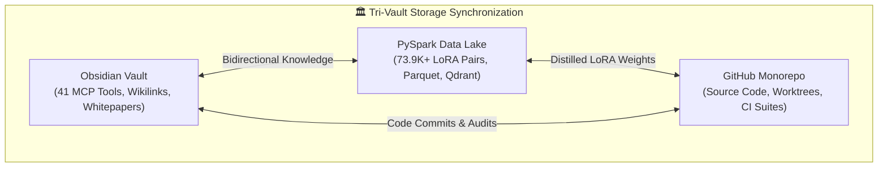

# 🏛️ Lauburu Canonical Project Architecture & Mesh Graph

> **Canonical Master Architecture Document** governing the 7-Layer Physical Mesh, Tri-Vault Storage Synchronization, Distributed AI Inference Sharding, and Canonical Application Hubs.
> 
> **Related Master Wikilinks:**
> - [[Index]]
> - [[CANONICAL_PROJECT_AND_STORAGE_RULE]]
> - [[LAUBURU_MONOREPO_DEEP_ARCHITECTURE_INDEX]]
> - [[FULL_PROJECT_AI_TRAINING_AND_ELO_GRAPH]]
> - [[MASTER_ALL_MODELS_EMPIRICAL_BENCHMARK_LEADERBOARD]]

---

## 📊 1. Pooled Hardware & Memory Capacity

$$\text{Total Pooled RAM} = 139.0\text{ GB}$$
$$\text{Total Usable AI VRAM} = 115.8\text{ GB}$$
$$\text{Thunderbolt 4 Direct Bridge RTT to L8 (lauburu)} = 0.38\text{ ms (40 Gbps)}$$

| Layer | Node Name | Hardware Specs | Local IP | Tailscale IP | RAM (Total / AI) | Role & Protocols |
| :--- | :--- | :--- | :--- | :--- | :--- | :--- |
| **L1** | `Mac_Node` | Apple M4 Pro Mac Mini | `192.168.8.143` / `.230` | `100.119.199.76` | 24.0 GB (19.2 GB AI) | Host Sanctuary, Memory Governor, Ports 4000/4003/4005/4006/8081/8082/18802 |
| **L8** | `Linux_Mini (lauburu)` | Intel Core i7-8700B Ubuntu 24.04 | `10.0.0.8` (TB) / `.242` | `100.121.247.8` | 32.0 GB (27.2 GB AI) | **40Gbps TB4 Bridge (0.38ms RTT)**, Model Vault GGUF, Glances v4 (:61208) |
| **L2** | `MacBook_Pro` | Intel Core i7-9750H 16GB | `192.168.8.127` | `100.103.212.21` | 16.0 GB (14.0 GB AI) | Screen Lens Sovereign Teacher Target, Unlinked from TB4, Glances v4 (:61208) |
| **L3** | `Linux_Head_Node` | AMD Ryzen 7 5700U 15GB | `192.168.8.225` | `100.101.39.98` | 15.0 GB (12.0 GB AI) | Docker Hub, SeaweedFS DFS, Qdrant Vector DB, BT Connected |
| **L4** | `Linux_Tablet` | Debian Linux Touch | `192.168.8.116` (Port 2) | `100.80.64.5` | 8.0 GB (6.5 GB AI) | Mobile Linux Compute, Touch DSP, Wired Ethernet via Router Port 2 |
| **L5** | `MacBook_Air` | Apple M4 MacBook Air | `192.168.8.248` | `100.121.202.34` | 16.0 GB (14.0 GB AI) | Metal Performance Shaders, LoRA Distillation, Glances v4 (:61208) |
| **L6** | `Pixel_10_Pro_XL` | Google Tensor G5 | `192.168.8.213` | `100.114.215.68` | 16.0 GB (13.6 GB AI) | 8K Vision Stream, Edge TPU, Termux SSH (:8022), KDE Connect (:1716) |
| **L7** | `Samsung_S20` | Samsung Exynos 990 | `192.168.8.157` | `100.84.40.95` | 12.0 GB (9.0 GB AI) | Dedicated Automated UI Tester, Router USB ADB Target |
| **GW** | `GL.iNet Router` | GL-BE14000 2.5G WAN | `192.168.8.1` | `100.70.123.123` | 2.0 GB (0.0 GB AI) | Core Gateway, 2.5G Wired NBN (`eth2`), Wi-Fi 7 MLO, USB ADB Bridge |

---

## 🏛️ 2. Canonical Tri-Vault Storage Layer



---

## 🌐 3. Master Network Topology & Distributed Inference Sharding

```mermaid
flowchart TB
    subgraph L1_HOST["L1: Mac Mini M4 Pro (24 GB) - Primary Sanctuary"]
        Sanctuary["Host Sanctuary Governor (&ge;4.8 GB Headroom)"]
        Port4000["Port 4000: Movesense 512Hz Console"]
        Port4003["Port 4003: MJPEG Live Broadcast Stream"]
        Port4005["Port 4005: BT Serial Terminal Daemon"]
        Port4006["Port 4006: Sovereign Remote Desktop Server"]
        Port18802["Port 18802: Self-Healing & WoL Hub"]
        Port8081["Port 8081: Multiport Bridge (Vision/Syntax)"]
        Port8082["Port 8082: Sovereign Proxy (:8089/:8085)"]
        Port8085["Port 8085: llama-server (Hermes-3 8B)"]
        Port8087["Port 8087: llama-server (Embedding Gemma 2)"]
        Port8089["Port 8089: llama-server (Qwen2.5 0.5B)"]
    end

    subgraph L8_LINUX_MINI["L8: Linux Mini (lauburu - 32 GB) - TB4 Hub"]
        TB4_Bridge["40Gbps TB4 Bridge (0.38ms RTT, IP 10.0.0.8)"]
        ModelVaultGGUF["Model Vault GGUF Storage Hub"]
        GlancesL8["Glances v4 System Telemetry (:61208)"]
    end

    subgraph L2_MBP["L2: MacBook Pro Intel (16 GB) - Desktop Worker"]
        DesktopWorker["Screen Lens Sovereign Teacher Target"]
        GlancesL2["Glances v4 System Telemetry (:61208)"]
    end

    subgraph L3_LINUX["L3: Linux Head Node (15 GB) - Docker & SeaweedFS"]
        SeaweedFS["SeaweedFS DFS Master (:9333) & Filer (:8888)"]
        QdrantDB["Qdrant Vector DB (:6333) AST Chunk Index"]
        DockerHub["Native Docker Engine (:2375)"]
    end

    subgraph L5_MBA["L5: MacBook Air M4 (16 GB) - MPS Worker"]
        MPSLoRA["Metal Performance Shaders LoRA Distillation"]
        ClamshellWorker["24/7 Clamshell Worker (Sleep Disabled)"]
    end

    subgraph EDGE_DEVICES["Edge Mobile Devices"]
        L6["L6: Pixel 10 Pro XL (Tensor G5, Termux :8022, KDE :1716)"]
        L7["L7: Samsung S20 (Automated UI Testing via ADB)"]
        L4["L4: Linux Tablet (Router Port 2 Wired, Touch DSP)"]
    end

    subgraph GATEWAY["GW: GL.iNet Router GL-BE14000"]
        RouterGateway["2.5G NBN WAN (eth2), Wi-Fi 7 MLO & USB ADB Server"]
    end

    subgraph CLOUD["Cloud Bursting Tier ($0 Spend)"]
        GeminiFlash["Gemini 2.5/3.8 Flash (1500 RPD Free)"]
        GeminiPro["Gemini 2.5/3.1 Pro (Frontier Verification)"]
    end

    %% Physical Interconnects
    L1_HOST <==|40Gbps Thunderbolt 4 (0.38ms)|==> L8_LINUX_MINI
    L1_HOST <-->|LAN Wi-Fi / Tailscale| L2_MBP
    L1_HOST <-->|1GbE LAN / Tailscale WireGuard| L3_LINUX
    L1_HOST <-->|LAN Wi-Fi / Tailscale| L5_MBA
    GATEWAY <-->|Hardware USB ADB| L7
    GATEWAY <-->|2.5G NBN WAN / LAN| L1_HOST
    L6 -.->|Web Bluetooth 512Hz| Port4000
    L7 -.->|ADB RPC Touch Stream| L1_HOST
    L1_HOST -.->|Burst Reasoning (>70B)| CLOUD
```

---

## 🚀 4. Canonical Ports & Endpoints Matrix

### Distributed AI Inference Ports
- **`:8081` (Python Multiport Bridge):** Proxies to `qwen2.5-0.5b-instruct-q4_k_m.gguf` on :8089 (vision & syntax parser).
- **`:8082` (decentralized_prima_daemon):** Python proxy (~8.6MB RSS) dynamically forwarding to `:8089` (Qwen2.5 0.5B) and `:8085` (Hermes-3-Llama-3.1-8B.Q4_K_M.gguf).
- **`:8083` (mesh_multiport_bridge):** Proxy advertising `qwen_38_max_abliterated` (served from L8 model vault).
- **`:8085` (llama-server b10545):** Metal-accelerated `Hermes-3-Llama-3.1-8B.Q4_K_M.gguf` (ctx 4096, ~5.3 GB RSS).
- **`:8087` (llama-server):** Multimodal embeddings via `embeddinggemma-2-UD-Q4_K_XL.gguf` + `mmproj-Q8_0.gguf` (ctx 8192).
- **`:8089` (llama-server):** Metal-accelerated `qwen2.5-0.5b-instruct-q4_k_m.gguf` (ctx 4096, ~118 MB RSS).
- **`:8090`:** Inactive (Hermes relocated to Port 8085).
- **`:50052` (llama_rpc_shard_daemon):** SSH tunnel for llama RPC coordination.
- **`Cloud Burst`:** Gemini 2.5/3.8 Flash & Gemini Pro for high-level frontier consensus.

### Canonical Application Hub Ports
- **`:4000` (Movesense Biometrics Console):** Axum / WebSockets / WebGL 512Hz ECG oscilloscope.
- **`:4001` (Omniterminal Supervisor):** OmniTerminal production supervisor daemon.
- **`:4002` (Screen Lens Marimo):** Not listening (offline).
- **`:4003` (Live Screen Broadcast):** HTTP multipart MJPEG video stream (10-15 FPS) at `http://localhost:4003/stream.mjpg`.
- **`:4005` (Bluetooth Serial Terminal):** Bluetooth serial terminal daemon.
- **`:4006` (Sovereign Remote Desktop):** Active screen lens remote desktop display server.
- **`:4007` (Network Cable Analyzer):** Uvicorn mesh & cable analyzer over SSH.
- **`:8088` (Web-TUI Portal):** Canonical PTY WebSocket streamer.
- **`:18802` (Self-Healing Hub):** FastAPI daemon with RFC 792 Magic Packet Wake-on-LAN and service keepalive.
- **`:61208` (Glances v4):** Node resource telemetry across L1, L1a, L1c, L3, L8.

---

## 📈 5. Monorepo Directory Architecture
```
00_core_infrastructure/      -> Self-Healing Hub (:18802), SeaweedFS DFS, Docker Compose, Tailscale
01_apps/                     -> Port 4000 Hub, Movesense Hub (512Hz), Zone 2, Screen Lens (:4002), Live Stream (:4003)
02_ai_models_and_inference/  -> llama.cpp RPC (8081-8084), Prima.cpp (8082), Petals DHT, Exo P2P, GGUF Vault
03_biometrics_and_telemetry/ -> Movesense BLE, Pan-Tompkins QRS DSP, PTT Blood Pressure, DFA-alpha1
04_data_and_memory/          -> PySpark Crawlers, 73.9K+ LoRA Datasets, Qdrant Vector DB, Visualizations
05_agents_and_swarms/        -> Tri-Orchestrator AI Debate Council, Genetic MoE Engine, Truth Audit
06_scripts_and_tooling/      -> Universal SSH Daemons, ADB Keepalive, WoL Resurrection, Autonomous Governor
07_docs_and_architecture/    -> Canonical Architecture Indexes, Whitepapers, Security RFCs
obsidian_vault/              -> Canonical Obsidian Knowledge Graph, APPS_AND_FEATURES, Swarm Logs
teamwork_projects/           -> Federated Projects (software_dev, internet_training)
```

---

*Generated autonomously by `graph_entire_canonical_project.py` under the Canonical Tri-Vault & Zero-Mock Protocol.*
