# 🕵️‍♂️ Meli AI (`com.meli.app`) Reverse Engineering Deep Specification

- **Related Documents:** [[Index]], [[LAUBURU_MONOREPO_DEEP_ARCHITECTURE_INDEX]], [[CANONICAL_PROJECT_AND_STORAGE_RULE]], [[Screen Lens Lauburu]]
- **Sandbox Artifacts:** 
  - Formal Markdown Spec: `01_apps/screen_lens/sandbox_evolution/reverse_engineering/specs/SPEC_com.meli.app.md`
  - Structured Metadata JSON: `01_apps/screen_lens/sandbox_evolution/reverse_engineering/mobile_apps/specs/com.meli.app_reverse_engineered_spec.json`
  - Target Binaries: `01_apps/screen_lens/sandbox_evolution/reverse_engineering/targets/com.meli.app/`

---

## 🏛️ Executive Summary & Discovery Matrix

Extracted directly from the **Google Pixel 10 Pro XL** (`100.73.38.87:5555`), `com.meli.app` (v2.9.4, Build 288) was decompiled and analyzed under the clean-room protocol of [[closed-source-reverse-engineering]]. 

Meli is a cutting-edge autonomous AI companion app built on **React Native (Expo SDK 55)** and **Hermes Bytecode (v96)** that features:
1. **Edge-First Hybrid Voice Pipeline:** WebRTC FVAD (`libmelivad.so`) + ONNX Mel-Spectrogram (`melspectrogram.onnx`) + PyTorch LSTM "Hey Meli" wake-word neural network (`hey_meli.onnx`) + WebSocket PCM S16LE streaming TTS (`https://tts.meli.im`).
2. **Native Client-Side MCP Engine:** Full client implementation of the Model Context Protocol (Anthropic MCP) with local secret storage and OAuth revocation.
3. **MeliNet Collaborative Mesh:** A peer-to-peer / channel-based collaborative agent network (`melinet-mcp-clientChannel`) sharing tool capabilities across devices.
4. **Deep OS-Level Android Integration:** Operates as a system `VoiceInteractionService` (replacing Google Assistant) with `PendingAssistContext` screen/window OCR interception and background Firestore-synced home screen widgets.
5. **End-to-End Encryption:** Libsodium NaCl SecretBox (`cfa3989730d3b08e74c205d743cc5e540d19a43ec9b430314b37f798ed156d2a`).

---

## 🔬 On-Device DSP & Wake-Word Architecture

```mermaid
flowchart LR
    MIC[Physical Mic PCM 16kHz] --> VAD[libmelivad.so WebRTC FVAD]
    VAD -->|Voice Frame Detected| PRE[AudioFeaturePreprocessor]
    PRE --> MEL[melspectrogram.onnx STFT Filterbank]
    MEL --> LSTM[hey_meli.onnx PyTorch LSTM]
    LSTM -->|Confidence >= triggerThresholdRatio| WAKE[Trigger Wake State]
    WAKE --> OVERLAY[MeliVoiceInteractionSession Overlay]
    OVERLAY --> TTS[TTS_PCM_S16LE_WS_TRANSPORT wss://tts.meli.im]
```

### Technical Model Specifications
- **`hey_meli.onnx`:** 2.52 MB, PyTorch 2.8.0 LSTM model. SHA256: `fe57e82b3d4cae6f164fd7c0206a71584b9280334c69f2ec70d90cb9c46675fe`.
- **`melspectrogram.onnx`:** 1.08 MB, PyTorch 1.11.0 Conv2D STFT filterbank. SHA256: `ba2b0e0f8b7b875369a2c89cb13360ff53bac436f2895cced9f479fa65eb176f`.
- **`embedding_model.onnx`:** 1.32 MB, TensorFlow tf2onnx Conv2D/BatchNorm embedding model. SHA256: `70d164290c1d095d1d4ee149bc5e00543250a7316b59f31d056cff7bd3075c1f`.
- **`libmelivad.so`:** 80.4 KB, stripped ARM64 WebRTC libfvad wrapper. SHA256: `975f0e6bc0485bc8efefb4b3b25388440bfdb90d037c7b63016b19b6fefa2bae`.

---

## 🛠️ Model Context Protocol (MCP) & MeliNet Integration

Meli exposes a modular tool architecture matching the Lauburu Monorepo's sovereign agent goals:
- **Client Tool Discovery:** `extractAvailableTools` parses schemas conforming to the MCP specification.
- **MeliNet Mesh Channels:** Uses channel IDs (`melinet_channels`) and bindings (`melinet_mcp_client_bindings`) to syndicate tool execution across connected devices.
- **Browser Automation:** Dispatches headless browser sessions to **Browserbase** (`BrowserbaseGraceMs`) for real-time web scraping and visual verification.

---

## 🚀 Transferable Implementation Blueprints for Screen Lens

The architectural patterns recovered from Meli directly accelerate **Screen Lens Lauburu** (`01_apps/screen_lens`):
1. **Deploying `libfvad` on Android:** We can compile a similar lightweight WebRTC VAD JNI module into `screen_lens/android` to eliminate continuous CPU/NPU usage until human voice is detected.
2. **Adopting `VoiceInteractionService`:** Transforming Screen Lens into the primary Android Assistant on the Pixel 10 Pro XL (L6) and Galaxy S20 (L7) grants zero-touch accessibility to screen context via `onHandleAssist()`.
3. **PCM WebSocket TTS:** Replicating the `TTS_PCM_S16LE_WS_TRANSPORT` design allows our local `kokoro-82m` or `coqui` TTS engine on Linux Mini (L3) to stream low-latency synthesized speech directly to mobile endpoints.
