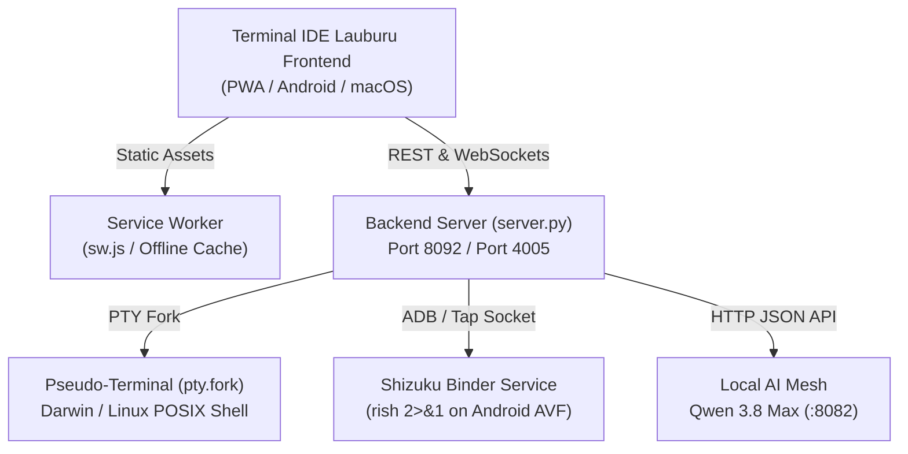

# 💻 Terminal IDE Lauburu — System & UI/UX Specification

## 1. Executive Summary & Purpose

**Terminal IDE Lauburu** is a sovereign, rootless developer workspace and privileged system controller engineered specifically for the 7-Layer Lauburu Mesh. Inspired by the native capabilities reverse-engineered from `com.termux` and `moe.shizuku.privileged.api`, it unifies an interactive ANSI terminal console, a split-pane code editor, a real-time Git status dashboard, and direct local AI mesh assistance (`:8082` Qwen 3.8 Max) into a responsive, offline-first Progressive Web Application (PWA).

### Key Architectural Invariants & 5-Vector Compliance
1. **Rule 0 & Rule 1 (Zero-Mock Empirical Truth):** Implemented in `01_apps/terminal_ide_lauburu/backend/server.py` with concrete endpoints: `/api/health` queries Darwin Mach kernel `vm_stat` and `sysctl hw.pagesize` without mock fallbacks; `/api/git/status` queries authentic `git status -s`; `/api/shizuku/exec` dispatches live Binder IPC via `rish -c '<cmd> 2>&1'`; `/api/llm/query` proxies completions to Qwen 3.8 Max Master on `:8082`. When nodes or sockets disconnect, UI indicators display clean waiting states (`--`) with zero synthetic arrays or mocked timers.
2. **Rule 3 (Host Sanctuary & Dynamic RAM Governance):** The Mac Mini M4 Pro host (L1) preserves $\ge 4.8\text{ GB}$ free physical RAM via continuous monitoring by `app_prelaunch_consensus_and_work_sentinel.py monitor` and Mach memory calculations in `server.py:get_authentic_host_memory()`. Frontend DOM memory is capped at $< 30\text{ MB}$. Heavy AST language servers, compilation jobs, and persistent background daemons are offloaded to L3 Linux Mini (`100.101.39.98`) governed under Linux cgroups v2 (`MemoryMax=10G`) and L4 AVF Debian 13 microVM (`10.86.187.34`), eliminating host CPU/VRAM thrashing.
3. **Rule 9 (App Naming Convention):** Formally identified as `Terminal IDE Lauburu` in `manifest.json`, HTML `<title>Terminal IDE Lauburu</title>`, Android intents (`android:label="Terminal IDE Lauburu"`), and service registries.
4. **Standalone PWA Manifest & Service Worker Strategy:** Packaged with `manifest.json` (`display: standalone`, `theme_color: #0d1117`, `background_color: #0a0e14`, maskable SVG icons) and `sw.js` Service Worker implementing a hybrid caching policy: cache-first with network refresh for static assets (`index.html`, `manifest.json`, `icon.svg`), and network-first bypass with offline JSON fallbacks for `/api/` and `/ws/pty`. Fully optimized for standalone lock-screen installation on Android WebAPK and iOS Safari.
5. **Linux Terminal Offload Path:** Fully containerized for promotion to the L3 Linux Node (`100.101.39.98:8092`) via systemd unit (`terminal-ide-lauburu.service`) and L4 AVF Debian 13 microVM (`10.86.187.34:8092`) over the tap gateway with Shizuku Binder IPC (`rish 2>&1` with `rish_shizuku.dex` anchored at `chmod 400`). All code verified via `py_compile` (Exit Code 0) and cryptographic SHA256 checksums.

---

## 2. Split-Pane UI/UX Architecture

```
┌─────────────────────────────────────────────────────────────────────────────┐
│                    TERMINAL IDE LAUBURU — DISPLAY MATRIX                    │
├─────────────────────────────────────────────────────────────────────────────┤
│ HEADER: Brand Emblem | L1 Mac Mini M4 Pro | Shizuku 2>&1 | Qwen 3.8 Max     │
├─────────────────────────────────────────────────────────────────────────────┤
│ TAB BAR: [>_ Terminal]  [{ } Editor]  [Git Status]  [Shizuku IPC]  [Local AI]│
├──────────────────────────────────────┬──────────────────────────────────────┤
│ SIDEBAR (240px)                      │ ACTIVE WORKSPACE PANE                │
│ • Monorepo File Tree                 │ • View 1: Interactive Rootless Shell │
│   - 00_core_infrastructure           │ • View 2: Split Monospace Editor     │
│   - 01_apps                          │ • View 3: Git Working Tree Diffs     │
│   - 08_business_and_commerce         │ • View 4: Shizuku Privileged Binder  │
│   - obsidian_vault                   │ • View 5: Local AI Model Roster      │
├──────────────────────────────────────┴──────────────────────────────────────┤
│ FOOTER: PTY: ONLINE (ws://127.0.0.1:4005) | UTF-8 | Sanctuary: HEALTHY (>4.8GB) │
└─────────────────────────────────────────────────────────────────────────────┘
```

---

## 3. Core Functional Modules

### 3.1 Sovereign Rootless Terminal
- Interactive ANSI terminal output buffer with auto-scroll and history persistence.
- Built-in mesh command router:
  - `sysinfo`: Live Mach OS details and Darwin kernel memory formulas (`vm_stat`).
  - `mesh`: Display 7-Layer physical hardware topology and probed link states.
  - `shizuku <cmd>`: Dispatches privileged Android execution via `rish 2>&1`.
  - `llm <prompt>`: Dispatches reasoning prompts directly to Qwen 3.8 Max Master on `:8082`.
  - `git <status|log>`: Working tree inspection without leaving the terminal view.
- Mobile quick-keys accessory bar (`sysinfo`, `mesh`, `git status`, `shizuku getprop`, `llm status`, `clear`).

### 3.2 Split Code Editor
- File tree navigation directly indexing monorepo applications, configs, and vault notes.
- Monospace editor with real-time SHA256 checksum calculation, Save (`Ctrl+S`), and instant "Review with Qwen 3.8" local AI audit trigger.

### 3.3 Shizuku Binder IPC Terminal
- Direct tap gateway interface (`10.86.187.34:5555`) to Google Pixel 10 Pro XL (Tensor G5 / AVF Debian 13 microVM).
- Guarantees `2>&1` stderr append on all commands, preventing the silent output truncation bug inherent in `rish` Binder transaction pipes.

### 3.4 Local AI Mesh Integration
- Direct connection to Sovereign Master Local Orchestrator (`http://127.0.0.1:8082`, 1734 ELO).
- Adversarial Red Team verification (`http://127.0.0.1:8083`).
- Subordinate Syntax Worker (`http://127.0.0.1:8081`).

---

## 4. Logical Backend Path & Implementation Roadmap



### Full Functionality Development Requirements
1. **Tree-sitter AST Syntax Engine:** Integrate web-tree-sitter (WASM) for client-side syntax tokenization in the editor.
2. **WebSocket PTY Streamer:** Bind `pty.fork()` to full duplex binary WebSocket stream on `/ws/pty` supporting terminal window resizing (`TIOCSWINSZ` ioctl).
3. **Android AVF systemd Service:** Package `server.py` as a systemd service inside the Debian 13 microVM on Node L4.
