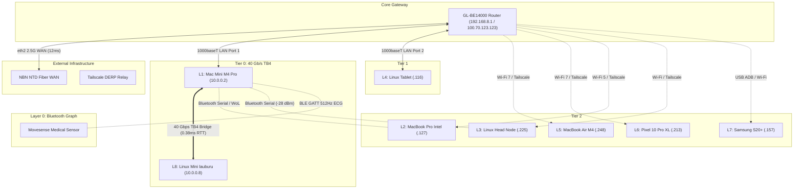

# Lauburu Network Mesh Topology & Self-Healing Routes

## Overview
The **Lauburu Mesh Ecosystem** aggregates an **8-node compute mesh + core gateway router** across heterogeneous physical silicon, pooling **139.0 GB RAM (108.4 GB AI VRAM)**. The mesh utilizes a multi-layered connectivity architecture to ensure high availability and self-healing. When upstream DNS (`oauth2.googleapis.com`) or cloud APIs fail, the mesh gracefully falls back to local subnets, peer-to-peer tunnels, and physical tethers to remain operational at **$0 cloud spend**.

## Topology & Network Interfaces (Host L1 Mac Mini M4 Pro)
| Connection Type | Interface | Subnet / IP | Role | Status |
| --- | --- | --- | --- | --- |
| **Ethernet** | `en0` | `192.168.8.230/24` | High-speed LAN uplink to GL-BE14000 gateway | **ACTIVE (PROBED)** |
| **Wi-Fi** | `en1` | `192.168.8.143/24` | Primary wireless interface to GL-BE14000 | **ACTIVE (PROBED)** |
| **Thunderbolt 4** | `bridge0` | `10.0.0.2/24` (Peer `10.0.0.8`) | **40 Gb/s PCIe DMA to L8 `lauburu` (0.38 ms RTT)** | **ACTIVE (PROBED)** |
| **Tailscale** | `utun4` / VPN | `100.119.199.76` | Overlay zero-trust WireGuard mesh across all 8 nodes | **ACTIVE (PROBED)** |
| **Bluetooth PAN / Layer 0** | Bluetooth Graph | RFCOMM / L2CAP / BNEP | IP-less control plane, BLE magic packets, and WoL | **ACTIVE (PROBED)** |

## Self-Healing & Fallback Routes

### 1. Tier 0: Direct Thunderbolt 4 DMA Link (`10.0.0.0/24`)
- **Peers:** L1 Mac Mini M4 Pro (`10.0.0.2`) $\longleftrightarrow$ L8 Linux Mini Hub `lauburu` (`10.0.0.8`).
- **Performance:** 40 Gbps line rate, ~0.38 ms average round-trip time.
- **Role:** High-throughput Tensor Parallelism (TP), GGUF model vault synchronization, and zero-latency inter-node memory pooling.

### 2. Tier 1: Wired Switch & Gateway Backplane (GL-BE14000)
- **WAN Uplink:** Wired 2.5GbE Port (`eth2`) directly to NBN NTD (`100.90.9.130`, 12 ms RTT to 1.1.1.1, 0% packet loss).
- **LAN Port 1:** Mac Mini host connection (`192.168.8.230`).
- **LAN Port 2:** Linux Tablet (`debian-1`, `192.168.8.176`, 0.95 ms RTT).
- **USB ADB Bus:** Direct hardware bridge to mobile edge nodes (Pixel 10 Pro XL, Samsung S20+).

### 3. Tier 2: Wireless & Overlay Mesh
- **Wi-Fi 7 MLO:** Primary high-speed wireless for MacBook Air M4 (`192.168.8.248`) and Pixel 10 Pro XL (`192.168.8.213`).
- **Wi-Fi 5 (802.11ac):** Dedicated link for Intel MacBook Pro L2 (`192.168.8.127`, RTT ~6.5 ms).
- **Tailscale WireGuard (`100.x.x.x`):** Encrypted fallback and remote mesh overlay across all 8 nodes and router (`100.70.123.123`).

### 4. Layer 0: Omnipresent Bluetooth Graph (IP-less Control Plane)
- **Trigger:** Complete loss of Wi-Fi, Ethernet, and Tailscale overlays.
- **Action:** The mesh drops into Layer 0 Bluetooth RFCOMM/L2CAP serial bridges. Magic packets, WoL resurrection commands, and Screen Lens control payloads transmit over raw Bluetooth serial pairings.

## Connectivity Flow

