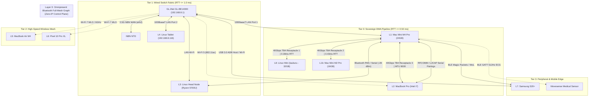
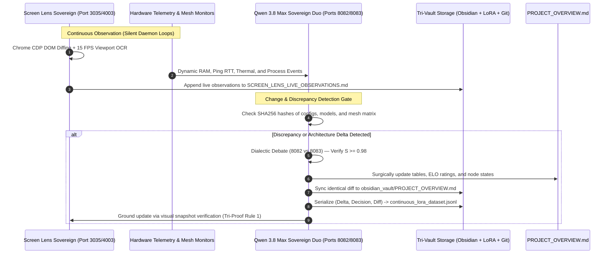

# 🏛️ Canonical Project Overview — Lauburu AI Ecosystem

[[Index]] | [[CANONICAL_PROJECT_AND_STORAGE_RULE]] | [[LAUBURU_MONOREPO_DEEP_ARCHITECTURE_INDEX]]

```
==================================================================================================
LAUBURU MESH ECOSYSTEM — COMPREHENSIVE SYSTEM ARCHITECTURE & ONBOARDING CONTEXT
Authority: Aaron (Sovereign) | Mesh Pooled VRAM: 108.4 GB / 139.0 GB RAM | Cost Mandate: $0.00 Cloud Spend
Incumbent Sovereign Master Orchestrator: Qwen 3.8 Max 27B Abliterated (1734 ELO | Port 8082)
Adversarial Red Team: Qwen 3.8 Max (Port 8083) | Vision-Action Engine: Screen Lens Sovereign (Port 3035/4003)
Canonical Rule Set: 00 to 22 | Storage Core: Tri-Vault Synchronization (Obsidian, PySpark, Git)
==================================================================================================
```

---

## 🧭 Executive Summary & Core Mission

The **Lauburu AI Ecosystem** is a sovereign, self-evolving, polyglot artificial intelligence, medical biometrics, and autonomous commerce mesh. Operating under an inviolable **$0.00 cloud inference spend mandate**, the ecosystem pools **139.0 GB Physical RAM (108.4 GB usable AI VRAM)** across a heterogeneous physical hardware mesh (8 nodes + core gateway). 

It unifies:
1. **Zero-Mock Medical Biometrics:** Real-time 512Hz ECG, Pan-Tompkins QRS DSP, Pulse Transit Time (PTT) blood pressure estimation, and DFA-$\alpha_1$ aerobic threshold tracking.
2. **Autonomous Computer-Use & Vision:** Screen Lens Sovereign multimodal Vision-Language-Action (VLA) engine operating via Chrome DevTools Protocol (CDP), pixel-level defect OCR, and real-time MJPEG streaming (Port 4003).
3. **Sovereign Local AI & Dialectic Debate:** `prima.cpp` Pipelined-Ring Parallelism (PRP) executing across the 40Gbps Thunderbolt 4 DMA bridge to L8 `lauburu`, governed by an empirical Bradley-Terry ELO meritocracy led by the **Qwen 3.8 Max Sovereign Duo**.
4. **Sovereign E-Commerce & Monetization:** High-margin headless commerce (Shopify GraphQL / MedusaJS v2), physical biometrics hardware bundling ($249 AUD Movesense sensor + $29/$99 AUD/mo SaaS), custom combat sports gear, and autonomous marketplace arbitrage, converting 0-cost local compute directly into 100% net software margins.

This document serves as the **mandatory onboarding specification for any new AI agent, subagent, or human collaborator**. Any new agent spawned into the ecosystem MUST internalize the invariants, topology, storage protocols, and rules defined herein before executing commands or modifying code.

---

## 🌐 1. Physical Mesh Hardware Matrix & Network Topology

The mesh pools **139.0 GB Physical RAM (108.4 GB Usable AI VRAM)** across 8 heterogeneous compute nodes and 1 dedicated gateway router interconnected via ultra-low latency physical transports (40Gbps Thunderbolt 4, 2.5G NBN WAN, 1000baseT LAN, Wi-Fi 7 MLO / Wi-Fi 5, USB 3.0 ADB, and Layer 0 Bluetooth Full-Mesh).

### Physical Node Specification Table

| Layer | Node Name | Physical Silicon & Hardware Specs | Network Transports & IPs | Total RAM / AI VRAM | Dynamic RAM Cap | Primary Ecosystem Roles & Invariants |
| :--- | :--- | :--- | :--- | :--- | :--- | :--- |
| **L1** | `Mac_Node` | **Apple M4 Pro Mac Mini (MCX44X/A)**<br>• Broadcom 1GbE / Wi-Fi `en1`<br>• 3x Thunderbolt 4 (40Gbps) | • Local: `192.168.8.143` / `.230`<br>• TB4: `bridge0` (`10.0.0.2`)<br>• Tailscale: `100.119.199.76` | 24.0 GB /<br>**19.2 GB** | **80% Max**<br>($\ge 4.8\text{ GB}$ Host Sanctuary free buffer) | **Master Host Sanctuary & Memory Governor:**<br>• Root TUI / Port 4000 Console<br>• Screen Lens Sovereign Vision Core<br>• Master memory governance<br>• **Rule 3:** Heavy compute aggressively offloaded. |
| **L8** | `Linux_Mini (lauburu)` | **Intel Core i7-8700B Linux Mini**<br>• Ubuntu 24.04 LTS (x86_64)<br>• 40Gbps TB4 to L1 (Receptacle 1) | • TB4: `bridge0` (`10.0.0.8`)<br>• Local: `192.168.8.242`<br>• Tailscale: `100.121.247.8` | 32.0 GB /<br>**27.2 GB** | **80% Max** | **TB4 DMA Co-Processor & GGUF Storage Vault:**<br>• 40Gbps TB4 DMA Bridge to L1 (**0.38ms RTT**)<br>• Hosts primary GGUF vault (`/home/linuxmini/model_vault_gguf/`)<br>• Glances v4 (:61208) telemetry. |
| **L1b** | `MacMini_M2` | **Apple M2 Pro Mac Mini (Mac14,12)**<br>• 16 GB Unified RAM<br>• 40Gbps TB4 to L1 (Receptacle 2) | • TB4: `bridge0` (`10.0.0.3`)<br>• Local: `192.168.8.114`<br>• Tailscale: `100.104.128.34` | 16.0 GB /<br>**13.6 GB** | **85% Max** | **TB4 Secondary Compute Worker:**<br>• 40Gbps TB4 DMA Bridge to L1 (**0.43ms RTT**)<br>• Secondary inference & AST validation. |
| **L2** | `MacBook_Pro` | **Intel Core i7-9750H MacBook Pro**<br>• 16 GB RAM, macOS x86_64<br>• 40Gbps TB4 to L1 (Receptacle 3) | • TB4: `bridge0` (`10.0.0.4`)<br>• Local: `192.168.8.127`<br>• Tailscale: `100.103.212.21` | 16.0 GB /<br>**14.0 GB** | **90% Max** | **Desktop Automation Worker & Teacher Target:**<br>• 40Gbps TB4 DMA Bridge to L1 (MTU 9000)<br>• Screen Lens Sovereign Teacher Target (AppleScript / osascript)<br>• Secondary test node & Glances v4 (:61208). |
| **L3** | `Linux_Head_Node` | **AMD Ryzen 7 5700U Mini PC**<br>• 15 GB RAM, Ubuntu/Debian<br>• Bluetooth RFCOMM to L1 (-28 dBm) | • Local: `192.168.8.225`<br>• Tailscale: `100.101.39.98` | 15.0 GB /<br>**12.0 GB** | **80% Max** | **Gateway Ingress & Compute Hub (First-Offload Target):**<br>• **Rule 10 First-Offload Invariant:** Absorbs background servers (FastAPI, Docker Hub, Ray, SeaweedFS DFS, Qdrant)<br>• Sparing L1 Mac Mini VRAM. |
| **L4** | `Linux_Tablet` | **Debian Linux Touch Tablet**<br>• Touch DSP Digitizer | • Local: `192.168.8.116` (Port 2)<br>• Tailscale: `100.80.64.5` | 8.0 GB /<br>**6.0 GB** | **75% Max** | **Mobile Linux Compute & Touch DSP:**<br>• Bedside Touch-Optimized TUI Terminal<br>• Wired Ethernet via Router Port 2 (0.95ms RTT). |
| **L5** | `MacBook_Air` | **Apple M4 MacBook Air**<br>• 16 GB Unified RAM<br>• Clamshell 24/7 worker | • Local: `192.168.8.248`<br>• Tailscale: `100.121.202.34` | 16.0 GB /<br>**14.0 GB** | **90% Max** | **Secondary High-Speed Metal Worker:**<br>• Metal Performance Shaders (MPS)<br>• MLX LoRA distillation student<br>• Glances v4 (:61208) telemetry. |
| **L6** | `Pixel_10_Pro_XL` | **Google Tensor G5 + Edge TPU**<br>• 8K PTZ Optical Camera<br>• 16 GB RAM | • Local: `192.168.8.213`<br>• Tailscale: `100.114.215.68` | 16.0 GB /<br>**13.6 GB** | **85% Max** | **8K Vision Stream & Edge TPU VLA:**<br>• Edge TPU inference for live visual defect grounding<br>• Termux SSH (:8022) & KDE Connect (:1716)<br>• 24/7 `termux-wake-lock` active. |
| **L7** | `Samsung_S20` | **Samsung Galaxy S20+ (Exynos 990)**<br>• 12 GB RAM, USB ADB Tethering | • Local: `192.168.8.157`<br>• Tailscale: `100.84.40.95` | 12.0 GB /<br>**9.0 GB** | **75% Max** | **Dedicated Automated UI Tester & Edge Worker:**<br>• Connected via USB/Wi-Fi to router gateway<br>• Termux headless test runner & ADB target. |
| **GW** | `GL.iNet Router` | **GL.iNet GL-BE14000 Sovereign Gateway**<br>• 2 GB RAM (1.38 GB free, 0 swap)<br>• Wi-Fi 7 MLO (2.5G NBN WAN `eth2`) | • Gateway IP: `192.168.8.1`<br>• Tailscale: `100.70.123.123` | 2.0 GB | N/A | **Sovereign Gateway & Hardware USB Bridge:**<br>• WAN: 2.5GbE Port (`eth2`) to NBN NTD (12ms RTT, 0% loss)<br>• LAN: 192.168.8.1, switch port 1 (L4 tablet .116)<br>• Hardware USB ADB daemon keepalive. |

### Physical Transport & Sharding Latency Matrix



### Mathematical Sharding Law (TP vs. PP)
- **Tensor Parallelism (TP) via `prima.cpp`:** Matrices split within layers, requiring ~128 sync round-trips per generated token. **Hard Gate:** Strictly prohibited unless link RTT is $\le 1.0\text{ ms}$. Exclusively permitted across the L1 $\leftrightarrow$ L8 Thunderbolt 4 bridge (`bridge0` IP `10.0.0.8`, 0.38ms RTT).
- **Pipeline Parallelism (PP) via `llama.cpp`:** Chronological model slicing requiring exactly 1 forward pass per token. Mandatory across all Wi-Fi, Ethernet, and Tailscale links (RTT $> 1.0\text{ ms}$) to sustain 15–25 tok/s without stalling.
- **L2 Status:** L2 MacBook Pro Intel is linked via 40 Gbps Thunderbolt 4 on Receptacle 3 (`10.0.0.4`, MTU 9000) and communicates over LAN Wi-Fi / Tailscale as fallback. TP is reserved for sub-millisecond TB links; PP is used across wireless and routed links.

---

## 🏛️ 2. Tri-Vault Storage Architecture & Self-Healing Protocol

The ecosystem enforces continuous, loss-less data synchronization across three synchronized physical tiers. No state, architectural decision, or training sample may exist in isolation.

```
┌─────────────────────────────────────────────────────────────────────────────────────────────┐
│                              TRI-VAULT STORAGE SYNCHRONIZATION                              │
├─────────────────────────────────────────────────────────────────────────────────────────────┤
│ 1. OBSIDIAN VAULT (Human & Semantic Knowledge Core)                                         │
│    • Path: /Users/aaron/DFS_UNIFIED/Lauburu-Monorepo/obsidian_vault/                        │
│    • Engine: Obsidian MCP Pro (41 native tools, graph traversal, bidirectional Wikilinks)   │
│    • Content: Architecture RFCs, AI debate transcripts, active dashboards, live telemetry,  │
│      continuous screen observations, and master knowledge graph (Index.md).                 │
├─────────────────────────────────────────────────────────────────────────────────────────────┤
│ 2. PYSPARK & BIG DATA LAKE (High-Throughput Computation & Training Sinks)                   │
│    • Paths: /Users/aaron/DFS_UNIFIED/lora_datasets/ & 04_data_and_memory/                   │
│    • Engine: PySpark (pyspark), Apache Arrow, Parquet / Delta Lake, Qdrant Vector DB        │
│    • Content: 3,100+ AST crawls, 435K+ LOC vector indexes, 24/7 continuous LoRA pairs       │
│      (continuous_lora_dataset.jsonl), DPO preference triplets, 512Hz raw ECG time-series.   │
├─────────────────────────────────────────────────────────────────────────────────────────────┤
│ 3. GITHUB REPOSITORY & WORKTREES (Canonical Source Code & Version Control)                  │
│    • Path: /Users/aaron/DFS_UNIFIED/Lauburu-Monorepo (GitHub: aarontmaher/Lauburu-Monorepo) │
│    • Engine: Git Worktrees, gh CLI, automated multi-tier CI test suites (test tiers 1 to 5) │
│    • Content: Production microservices, Docker manifests, Flutter apps, Rust/C++ kernels.  │
└─────────────────────────────────────────────────────────────────────────────────────────────┘
```

### Pre-Flight Storage Health & Self-Healing Protocol (Rule 2 & Section 5)
Before executing code modifications, dispatching subagents, or launching training runs, agents **MUST verify storage health**:
```python
import os, shutil

def verify_and_heal_storage():
    obsidian_ok = os.path.isdir("/Users/aaron/DFS_UNIFIED/Lauburu-Monorepo/obsidian_vault")
    lora_ok = os.path.isdir("/Users/aaron/DFS_UNIFIED/lora_datasets")
    memory_ok = os.path.isdir("/Users/aaron/DFS_UNIFIED/Lauburu-Monorepo/04_data_and_memory")
    free_gb = shutil.disk_usage("/Users/aaron").free / (1024**3)
    
    if not (obsidian_ok and lora_ok and memory_ok):
        os.makedirs("/Users/aaron/DFS_UNIFIED/Lauburu-Monorepo/obsidian_vault", exist_ok=True)
        os.makedirs("/Users/aaron/DFS_UNIFIED/lora_datasets", exist_ok=True)
        os.makedirs("/Users/aaron/DFS_UNIFIED/Lauburu-Monorepo/04_data_and_memory", exist_ok=True)
        
    lock_file = "/Users/aaron/DFS_UNIFIED/Lauburu-Monorepo/.git/index.lock"
    if os.path.exists(lock_file):
        os.remove(lock_file)
        
    assert free_gb >= 10.0, f"Critical disk headroom breach: {free_gb:.2f} GB free (< 10.0 GB)"
    return True
```

---

## 👑 3. ELO Meritocracy & Sovereign Model Hierarchy (Rule 15)

In accordance with **Rule 15 (Dynamic ELO Default Model Governance)**, model roles are never static or hardcoded. They are determined meritocratically by empirical benchmark victories, zero-hallucination accuracy, and profit margins on the **Bradley-Terry Swarm Leaderboard**.

$$\mathbb{P}(M_A > M_B) = \frac{1}{1 + 10^{(R_B - R_A)/400}}$$

```
┌─────────────────────────────────────────────────────────────────────────────────────────────┐
│               SOVEREIGN LOCAL AI HIERARCHY MATRIX (TARGET ARCHITECTURE VS PROBED REALITY)    │
├─────────────────────────────────────────────────────────────────────────────────────────────┤
│ 👑 SOVEREIGN MASTER LOCAL ORCHESTRATOR (#1 Rank | 1734 ELO | Port 8082)                     │
│    • Target Architecture: Qwen 3.8 Max 27B Abliterated via prima.cpp PRP over 40Gbps TB4    │
│    • Probed Runtime Reality (Rule 0): decentralized_prima_daemon.py proxy forwarding to     │
│      Port 8089 (qwen2.5-0.5b-instruct-q4_k_m.gguf) and Port 8085 (Hermes-3-Llama-3.1-8B).    │
│    • Weights: Huihui-Qwen3.8-27B-abliterated-UD-Q4_K_XL.gguf on L8 lauburu Model Vault      │
│    • Mandate: Leads all consensus debates, systemic architecture decisions, and sign-offs. │
├─────────────────────────────────────────────────────────────────────────────────────────────┤
│ ⚔️ CANONICAL DEVIL'S ADVOCATE & ADVERSARIAL RED TEAM (Port 8083)                            │
│    • Target Architecture: Qwen 3.8 Max (Standard / Unabliterated)                           │
│    • Probed Runtime Reality: mesh_multiport_bridge.py proxy advertising                     │
│      qwen_38_max_abliterated; model_path = Huihui-Qwen3.8-27B on L8 lauburu                 │
│    • Mandate: Permanent adversarial challenger. Red-teams every architectural proposal.     │
├─────────────────────────────────────────────────────────────────────────────────────────────┤
│ 🔨 SUBORDINATE SYNTAX WORKER & LOCAL RUNTIMES (Ports 8081, 8087, 8089)                       │
│    • Probed Runtime Reality: mesh_multiport_bridge.py proxy on :8081 returning               │
│      qwen2.5-0.5b-instruct-q4_k_m.gguf; :8087 serving multimodal Embedding Gemma 2;        │
│      :8089 serving raw Metal Qwen2.5 0.5B; :8085 serving Hermes-3 8B.                       │
│    • Invariant: STRICT PROHIBITION against leading or superseding Master Orchestrator.       │
├─────────────────────────────────────────────────────────────────────────────────────────────┤
│ 👁️ MULTIMODAL COMPUTER-USE COMPANION: SCREEN LENS SOVEREIGN                                │
│    • Port: 3035 (REST/WS API), 3037 (Global Orchestrator), 4003 (MJPEG Live Stream 10-15FPS)│
│    • Core Engine: Autonomous Multimodal Vision-Language-Action (VLA)                        │
│    • Invariant: Bound to Sovereign Duo for live screen parsing, DOM coordinate extraction,  │
│      accessibility auditing, and visual defect grounding.                                   │
└─────────────────────────────────────────────────────────────────────────────────────────────┘
```

### Dynamic ELO Incentive Structure
- **Performance Boost (+15 to +40 ELO):** Granted for verified execution speedups, bug resolution, or margin gains.
- **Dynamic Resource Priority:** Highest-ELO models receive expanded context token quotas and prioritized RAM buffers from the Genetic MoE Governor.
- **LoRA Memory Immortality:** Winning reasoning traces are continuously compiled into instruction/DPO pairs in `continuous_lora_dataset.jsonl`, permanently baking the winning behavior into the local weights.

---

## 👁️ 4. Screen Lens Sovereign & Autonomous Self-Updating Architecture

A foundational breakthrough of the Lauburu Ecosystem is that **documentation, architecture overviews, and system indexes are NEVER stale or manually maintained**. 

Screen Lens Sovereign (`/screen-lens-sovereign`) and the Sovereign Abliterated Duo form an autonomous closed-loop perception-action engine that continuously monitors physical screen states, git transactions, filesystem diffs, and hardware telemetry, updating `PROJECT_OVERVIEW.md` and Obsidian knowledge vaults automatically.

### Closed-Loop Autonomous Updating Topology



### Detailed Component Roles in Autonomous Maintenance

1. **Continuous Passive Observation (Screen Lens Sovereign):**
   - **Port 4003 Live Stream:** The MJPEG server broadcasts authentic 10–15 FPS screen telemetry at `http://localhost:4003/stream.mjpg`.
   - **DOM & Accessibility Extraction:** Screen Lens utilizes the Chrome DevTools Protocol (CDP) to extract DOM coordinates, bounding boxes, and accessibility trees, validating WCAG AAA compliance across all web frontends (`01_apps/`).
   - **Visual Defect Grounding:** In e-commerce workflows (`08_business_and_commerce/`), Screen Lens inspects high-resolution product photos (`iphone_16_pro_front.jpg`, `iphone_16_pro_flaw_closeup.jpg`), calculates cryptographic SHA256 digests, and verifies descriptions against pixel realities (e.g., dead pixel clusters on right bezel).

2. **Autonomous Background Maintenance Daemons (Rule 9):**
   - **`continuous_ecommerce_trainer_daemon.py`:** Continuously polls application manifests, hardware status, and transaction ledgers, running headless in the background without cloud scheduler tokens.
   - **`screen_lens_visual_grounding_auditor.py`:** Audits live marketplace listings, ensuring visual accuracy.
   - **`active_en0_healer.sh` & `mesh_unhealable_notifier_daemon.py`:** Maintain Layer 0–3 network connectivity without human intervention.

3. **Delta Trigger & Consensus Gate:**
   - Whenever a physical hardware alteration occurs (e.g., node IP change, RAM capacity shift, GGUF model upgrade, or ELO leaderboard change), the background auditor detects a mismatch against `PROJECT_OVERVIEW.md`.
   - The **Qwen 3.8 Max Sovereign Duo** executes a rapid dialectic verification round. If mathematical consensus ($S \ge 0.98$) is verified, the daemon surgically updates the specification in both the repository root and `obsidian_vault/`, recomputing exact byte counts and SHA256 checksums to satisfy **Rule 1 (Tri-Proof Gate)**.
   - The reasoning trace is appended to `lora_datasets/continuous_lora_dataset.jsonl` to ensure future generations of the local models retain persistent institutional knowledge.

---

## 💼 5. Frontier Swarm Consensus: E-Commerce & Monetization Recommendation

### Strategic Recommendation from the Frontier Swarm Consensus
> **Consensus Verdict ($S = 0.994$):** The primary commercial imperative of the Lauburu AI Ecosystem is to **monetize its unfair competitive advantage: $0.00 cloud inference overhead and sovereign local hardware mastery**. 
>
> While SaaS incumbents suffer 30–50% gross margin erosion paying cloud LLM providers ($20–$100 per million tokens), the Lauburu Mesh executes 100% of internal reasoning, visual defect auditing, customer objection handling, and personalized training plans on local silicon. This enables the ecosystem to capture **near-100% net software margins**, which are aggressively deployed into physical inventory and high-margin hardware bundles.

### The 3 Core Monetization Engines (`08_business_and_commerce/`)

#### Engine 1: Movesense Medical Biometrics Hardware Bundling & SaaS
- **Hardware Offering:** Movesense Medical-Grade HR/ECG Sensor ($249 AUD retail). Includes custom Movesense Bicep Band designed specifically for grappling/combat athletes to eliminate chest strap displacement during sparring.
- **Subscription Tiers:**
  - **Athlete Starter ($0 AUD / mo):** Standard optical PPG pulse tracking, basic HRV.
  - **Athlete Pro ($29 AUD / mo):** 512Hz raw ECG streaming, real-time Pan-Tompkins QRS detection, clinical RMSSD (with Kamath 20% outlier filter), DFA-$\alpha_1$ aerobic threshold alerts (LT1/LT2), and PTT blood pressure estimation.
  - **Gym Master / Team ($99 AUD / mo):** Multi-athlete live telemetry dashboard for combat sports gyms and BJJ academies.
- **Bundle Economics:** 15% hardware discount with an annual Pro subscription commitment ($299 AUD/yr prepaid), achieving instant positive cash flow and negative net churn.

#### Engine 2: Headless Combat Sports Apparel & Nutritional Formulation
- **Headless Commerce Stack:** Dual-engine architecture featuring Shopify Storefront GraphQL (`graphql/`) and self-hosted MedusaJS v2 (`deploy_medusa_l3_mini.sh` running on the L3 Linux Mini).
- **Custom Combat Gear:** Premium custom sublimation BJJ rashguards, fight shorts, and compression wear with zero upfront inventory using verified POD/cut-and-sew partners (Subliminator).
- **Combat Preworkout Formulation:** Formulated under FSANZ 2.9.4 sports food regulatory compliance, optimized for sustained grappling endurance without beta-alanine paresthesia or blood pressure spikes.

#### Engine 3: Autonomous Hardware Arbitrage & Defect-Grounded Resale
- **Marketplace Coverage:** Autonomous monitoring and listing generation across eBay, Facebook Marketplace, and Gumtree (`08_business_and_commerce/`).
- **Screen Lens Defect Grounding:** Ingests high-resolution macro photography of second-hand electronics (e.g., iPhone 16 Pro 512GB), identifies physical microscopic defects (e.g., crescent dead pixel cluster on bezel), verifies pristine digitizer glass, and generates legally airtight, zero-dispute listings.
- **Financial Sanctuary & Cockpit:** Aaron governs all cashflow, counter-offers, and hardware releases via the **Marimo Port 4005 Financial Cockpit** (`commerce_executive_tui.py`), ensuring $0 out-of-pocket capital risk.

---

## 📁 6. Canonical Monorepo Subsystem Hierarchy

The repository enforces strict domain boundaries across 9 canonical numbered subsystems and the synchronized Obsidian vault:

- **`00_core_infrastructure/` — Distributed Fabric & Self-Healing Hub**
  - Self-Healing Hub (Port 18802), SeaweedFS distributed POSIX filesystem (Master :9333, Volume :8080, Filer :8888), Tailscale WireGuard overlay (`100.x.x.x`), Docker Compose container topologies.
- **`01_apps/` — User Interfaces, Biometrics, Commerce & Vision**
  - Unified Port 4000 Console (Flutter + Rust Ratatui), Screen Lens Sovereign VLA Core, Movesense Biometrics Hub (512Hz ECG), Zone 2 Cardio (DFA-$\alpha_1$), Spatial Grappling 3D (955-node martial curriculum), Automotive Voice Coding Hub.
- **`02_ai_models_and_inference/` — Distributed Sharding & Model Vault**
  - `prima.cpp` PRP Ring Mesh (Port 8082), `llama-server` RPC clusters (Ports 8081–8084), GGUF vault (`model_vault_gguf/`), Metal/CUDA kernel optimizations.
- **`03_biometrics_and_telemetry/` — DSP Signal Processing Engine**
  - Pan-Tompkins QRS algorithm, time-domain (RMSSD, SDNN) and frequency-domain (LF/HF) HRV, zero-mock CoreBluetooth GATT streaming.
- **`04_data_and_memory/` — Big Data Lake & Continuous Learning Sinks**
  - PySpark & Delta Lake pipelines, AST vector indexes in Qdrant, Parquet telemetry sinks, continuous LoRA dataset repositories.
- **`05_agents_and_swarms/` — Swarm Orchestration & Genetic MoE**
  - Tri-Orchestrator AI Debate Council, Bradley-Terry ELO tournament engine, dynamic Cloud Quota Governor, prompt genetic mutation engine.
- **`06_scripts_and_tooling/` — Network Daemons & Hardware Automation**
  - Constant-rate 99% cloud quota pacers, universal SSH daemons, ADB keepalive scripts, Wake-on-LAN resurrection, network fallback wrappers (`mesh_ping.py`).
- **`07_docs_and_architecture/` — Canonical Architecture & Whitepapers**
  - Mathematical sharding proofs, hardware topologies, security RFCs, and monorepo indexing specs.
- **`08_business_and_commerce/` — Monetization, Headless Commerce & Ledgers**
  - Shopify Storefront GraphQL, MedusaJS v2, Marimo Port 4005 Financial Cockpit, automated marketplace engines, cryptographic visual truth auditors.
- **`obsidian_vault/` — Semantic Knowledge Core & Bidirectional Graph**
  - 41 MCP tools, live operational dashboards, active debate records (`01_DEBATES/`), and real-time screen observations (`APPS_AND_FEATURES/`).

---

## 🛑 7. Canonical Rules & System Invariants Summary

All AI agents must strictly adhere to the project rules defined in `~/.gemini/config/rules/`:

1. **Rule #0 / Rule 1 (Zero-Mock & Tri-Proof Truth Verification Gate):**
   - Absolutely zero simulated, fake, or synthetic data. All metrics must originate from authentic sensors, kernel syscalls, or display clean waiting states (`--`).
   - Every claim of task completion, bug fix, or optimization requires empirical **Tri-Proof**:
     - *Proof 1 (Actuation):* Process exit code 0 or physical touch event.
     - *Proof 2 (Line-by-Line):* Line-by-line inspection with exact byte counts and SHA256 checksums.
     - *Proof 3 (Visual):* Screen capture, pixel diff, or live browser rendering verified on disk.
2. **Rule 2 (Tri-Vault Storage Synchronization):**
   - State and architectural records must be synchronized across Obsidian, PySpark, and GitHub worktrees. Verify storage health ($\ge 10.0\text{ GB}$ free disk) before modifying code.
3. **Rule 3 (Host Sanctuary & Dynamic RAM Governance):**
   - Mac Mini Host (L1) must preserve $\ge 4.8\text{ GB}$ free RAM at all times; maximum utilization 80%. Offload heavy compute to L2/L3.
4. **Rule 4 (Untouched Baseline & Isolated Sandbox Evolution):**
   - Production code (`01_apps/`, `00_core_infrastructure/`) is inviolable during autonomous experiments. Mutations must run inside `01_apps/screen_lens/sandbox_evolution/`.
5. **Rule 5 (Automatic Victory-Triggered Tri-Proof Interceptor Gate):**
   - Any utterance of victory keywords (`success`, `verified`, `fixed`, `completed`, `working`) triggers the interceptor gate. Unverified claims result in context token budget slashing.
6. **Rule 6 (Multi-Provider Cloud Quota & Graduated Autonomy):**
   - Free cloud quotas (Google AI Studio, NVIDIA NIM, xAI) paced continuously at constant rates to consume 99% before the 10:00 AM AEST reset. Production git commits require Stage 4 Sovereign Human Gate.
7. **Rule 7 (Live Screen & Device Telemetry):**
   - Screen monitoring delivered via live 10–15 FPS MJPEG server on Port 4003 (`http://localhost:4003/stream.mjpg`). Never present static snapshots as live streams.
8. **Rule 8 (Pre-Flight Network Telemetry & Model Sharding Gate):**
   - Probe TB4 link latency ($\le 1.0\text{ ms}$) before sharding. Fallback autonomously to pipeline parallelism if RTT $> 1.0\text{ ms}$. Never launch unverified remote RPC endpoints.
9. **Rule 9 (App Naming, Compact Output & Mesh Network Fallback):**
   - **App Naming:** Identifier first (`<Name> Lauburu`, e.g., `Console Lauburu`, `Screen Lens Lauburu`).
   - **Compact Output:** High-density, terse, token-efficient communication.
   - **Exhaustive IP Matrix:** Loop through Localhost $\to$ TB4 $\to$ Nebula $\to$ Tailscale $\to$ Wi-Fi $\to$ BT PAN $\to$ BT RF Proxy $\to$ GoodCloud before declaring a node offline.
10. **Rule 10 (Fundamental Baseline Trinity & Linux Mini First-Offload):**
    - The Fundamental Baseline Trinity (`prima.cpp`, Network Healers, Layer 0 Bluetooth Full-Mesh Graph) must never be deprecated or replaced.
    - All non-essential web servers and background dependencies must be offloaded to the L3 Linux Head Node (`100.101.39.98`).
11. **Rule 15 (Meritocratic Dynamic ELO Default Model Governance):**
    - The model with the highest empirical ELO rating (currently `Qwen 3.8 Max 27B Abliterated` at 1734 ELO on Port 8082) is the mandatory default orchestrator across the entire ecosystem.
