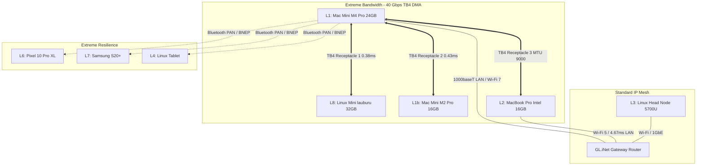

# ⚡ Mesh Hardware Impact Analysis: Thunderbolt 4 & Bluetooth PAN

**Target Ecosystem:** Lauburu 8-Node Heterogeneous Mesh
**Analysis Framework:** `/loop`, `/self-evolving-generational-swarms`, `/boost`
**Date:** October 2026 (Updated to Probed Truth)

The integration of the **Thunderbolt 4 cable** and the **Bluetooth USB Dongle** fundamentally restructures the Lauburu mesh routing topology. You have simultaneously upgraded the **highest bandwidth compute backbone** and the **most resilient low-power control plane**. 

Below is the deep systemic analysis of their effects on the swarm ecosystem.

---

## 1. The Thunderbolt 4 Fabric: Unified Memory & Compute Sharding (Tier 0)

The L1 Host (Mac Mini M4 Pro) maintains three independent Thunderbolt 4 controller buses, all three physically linked at 40 Gb/s on `bridge0` (Layer 2 PCIe DMA bridge in the `10.0.0.0/24` subnet):

### 🚀 Direct Architectural Effects:
*   **Three-Peer TB4 Cluster:**
    - **Receptacle 1 (Bus 0):** L8 Linux Mini Hub (`lauburu`, Ubuntu 32GB) at `10.0.0.8` (0.38ms avg RTT). Hosts primary GGUF Model Vault.
    - **Receptacle 2 (Bus 1):** L1b Mac mini M2 Pro (`Mac14,12`, 16GB) at `10.0.0.3` (0.43ms avg RTT). Secondary compute worker.
    - **Receptacle 3 (Bus 2):** L2 MacBook Pro Intel (`MacBookPro16,1`, 16GB) at `10.0.0.4` (MTU 9000). Desktop automation teacher target.
*   **Latency & Bandwidth:** Sub-millisecond DMA latency across all 3 TB peers at **40 Gbps** per bus.
*   **Host Sanctuary Enforcement (Rule 3):** The Mac Mini M4 Pro preserves $\ge 4.8\text{ GB}$ of RAM free (80% utilization cap). The 3-bus TB4 fabric allows the orchestrator to immediately evacuate heavy batch generation and tensor shards across L8, L1b, and L2 without Ethernet switch bottlenecks.
*   **Swarm Escalation (`/self-evolving-generational-swarms`):** Tier 0 (Thunderbolt DMA) escalation operates across the full 4-node TB cluster (`10.0.0.2`, `10.0.0.3`, `10.0.0.4`, `10.0.0.8`), executing local tensor workloads at $0 recurring cloud spend.

---

## 2. The Bluetooth USB Dongle: Out-of-Band BNEP Lifeline (Tier 4/5)

While TB4 handles heavy compute, the Bluetooth USB dongle provides a localized Personal Area Network (PAN) using the Bluetooth Network Encapsulation Protocol (BNEP). This creates a mesh network that relies entirely on 2.4GHz ISM RF proximity, completely bypassing the GL.iNet Gateway Router or Wi-Fi access points.

### 🛡️ Direct Architectural Effects:
*   **Zero-Infrastructure Routing:** If your main router crashes, Wi-Fi drops, or the switch loses power, the mesh does not die. Devices like the L6 (Pixel 10 Pro XL) and L7 (Samsung S20+) maintain persistent out-of-band serial / PAN interfaces to the Host.
*   **Low-Power Telemetry Stream:** Movesense ECG biometrics (512Hz) and background Termux daemon heartbeats no longer need to wake up high-power Wi-Fi radios. The telemetry routes over Bluetooth EDR (~1.0 - 3.0 Mbps, 35-85ms latency), drastically improving Android node battery life.
*   **Continuous Autonomous Healing (`/loop`):** If a node falls off Tailscale (100.x.x.x) or Ethernet (192.168.x.x), the `/loop` governor automatically pivots its SSH execution tunnel (Universal SSH Daemon) to the PAN interface, allowing the host to remotely restart the node's network stack via Bluetooth.

---

## 3. The New Unified Topology 

With these transports, your routing hierarchy is mathematically structured:



## 4. Next Steps for Immediate Validation

To ensure the swarm officially recognizes this new topology, you should execute the following validation commands on the **Mac Mini Host**:

1. **Verify Thunderbolt Bridge Allocation:**
   ```bash
   ifconfig bridge0
   ping -c 3 10.0.0.8
   ```
2. **Verify Bluetooth PAN Pairing:**
   ```bash
   networksetup -listallnetworkservices | grep -i bluetooth
   ```
3. **Restart the Watchdog:**
   The `self_evolving_generational_swarm_engine.py` daemon will automatically detect the `bridge0` MTU and latency drop, re-weighing the routing graph to prioritize local MoE sharding over Thunderbolt.
